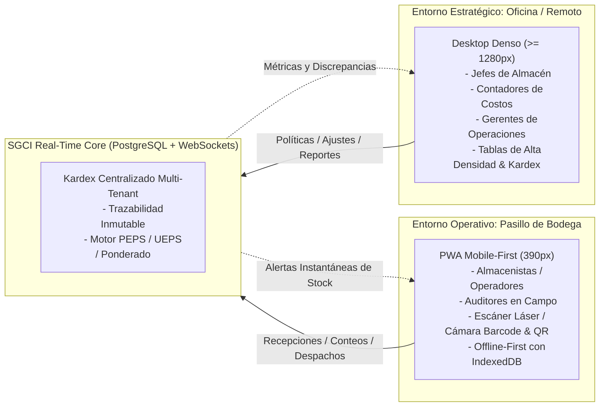

# SGCI — Especificación Operativa de Producto

> **Documento Rector de Estrategia de Producto, Experiencia Operativa y Principios de Diseño Funcional.**

---

## 1. Visión del Producto y Propuesta de Valor

**SGCI (Sistema de Gestión de Control de Inventarios)** es una solución SaaS B2B Multi-Tenant diseñada para erradicar las discrepancias entre el mundo físico de los almacenes y el registro contable-administrativo de las empresas.

A diferencia de los ERPs tradicionales lentos y monolíticos, o de hojas de cálculo vulnerables y desarticuladas, SGCI ofrece una **experiencia dual adaptativa**:
1. **Herramienta de Pasillo Ultraligera (Mobile-First PWA):** Diseñada para la velocidad de digitación y escaneo de los operadores de bodega, eliminando el uso de papel en recepciones, picking y conteos.
2. **Centro de Mando Analítico (Desktop Denso):** Diseñado para la precisión de jefes de almacén, compradores y contadores de costos que exigen tablas con alta densidad informativa, filtros multicriterio y valorización exacta de existencias.

---

## 2. Experiencia Operativa Dual

### 2.1. Experiencia Mobile-First (Viewport Base: 390px)
- **Destinatarios:** `almacenista_operador`, `auditor_inventario`, `supervisor_inventario`.
- **Condiciones de uso reales:**
  - Operadores de pie o sobre montacargas, sosteniendo el dispositivo con una mano o montado en la muñeca.
  - Uso frecuente de guantes de trabajo industrial.
  - Almacenes con zonas oscuras o de iluminación fluorescente intensa.
  - Redes Wi-Fi industriales inestables con zonas muertas ("blackouts") entre estanterías metálicas altas.
- **Directrices de Interfaz y Ergonomía:**
  - **Targets táctiles generosos:** Botones con un mínimo de `48x48px` y separación de `8px`.
  - **Acceso con el pulgar (Thumb-Zone):** Controles críticos de escaneo, confirmación y teclado numérico ubicados en el tercio inferior de la pantalla.
  - **Retroalimentación multisensorial:** Sonido de confirmación (bip agudo para éxito, tono grave para error) y vibración háptica al validar un código de barras.
  - **Modo escaneo continuo:** Permite registrar múltiples artículos consecutivos sin necesidad de presionar botones adicionales entre lecturas.

### 2.2. Experiencia Desktop Denso (Viewports >= 1280px)
- **Destinatarios:** `admin_tenant`, `jefe_almacen`, `contador_costos`, `gerente_operaciones`, `comprador_abastecimiento`.
- **Condiciones de uso reales:**
  - Estaciones de trabajo fijas con monitores de 24"+ o laptops de alta resolución.
  - Necesidad de visualizar cientos de filas de movimientos Kardex y analizar capas de costos simultáneas.
  - Uso intensivo de atajos de teclado (`Alt + N` nuevo ajuste, `Ctrl + F` filtro global, `Esc` cerrar paneles).
- **Directrices de Interfaz:**
  - **Tablas de alta densidad de datos:** Filas compactas (32px-36px de altura), tipografía tabular monoespaciada para valores numéricos y cantidades.
  - **Filtros avanzados combinables:** Por almacén, rango de fechas, categoría, estado de lote, proveedor y tipo de movimiento.
  - **Vistas divididas (Master-Detail):** Panel maestro con listado de órdenes/conteos y panel lateral deslizable con desglose de ítems, números de serie y lotes asociados.
  - **Exportación nativa:** Exportación con un solo clic a formatos Excel (`.xlsx`), CSV y PDF formal con membrete de la empresa.

---

## 3. Principios Inmutables de Producto

Los siguientes cinco principios rigen todas las decisiones técnicas y funcionales dentro de SGCI:

### 1. Trazabilidad Inmutable en Kardex
*Ningún movimiento de inventario se elimina ni se sobreescribe.*
- Todo incremento o decremento de existencias genera un registro inmutable en el Kardex (`inventario_kardex`).
- Si se cometió una equivocación en una recepción o despacho, el sistema no permite el borrado físico (`DELETE`) ni la alteración de la cantidad histórica; exige la creación de una transacción de contraasiento o ajuste con justificación técnica y firma digital del usuario responsable.

### 2. Cero Movimientos Huérfanos
*Ninguna unidad física se mueve sin un documento de respaldo.*
- Cada entrada, salida, traslado o merma debe estar vinculada obligatoriamente a una entidad de origen válida:
  - Entrada por compra $\rightarrow$ Número de Orden de Compra y Recepción.
  - Salida por venta/despacho $\rightarrow$ Nota de Despacho o Pedido.
  - Movimiento inter-almacén $\rightarrow$ Guía de Transferencia Interna.
  - Disminución por daño o caducidad $\rightarrow$ Acta de Merma autorizada.
  - Variación por conteo $\rightarrow$ Acta de Ajuste de Conciliación de Inventario Físico.

### 3. Escaneo en 2 Toques (Zero-Friction Scanning)
*La velocidad en pasillo es el factor determinante de adopción.*
- El flujo estándar de captura no debe exigir más de dos interacciones táctiles:
  1. **Toque 1:** Apuntar el lector/cámara y capturar el SKU, EAN-13 o código QR del producto/ubicación.
  2. **Toque 2:** Confirmar cantidad detectada o teclear la cifra en el teclado numérico de pantalla completa y presionar "Registrar".
- El cursor se mantiene autoseleccionado en el campo de escaneo de forma continua.

### 4. Resiliencia PWA ante Cortes Wi-Fi en Bodega
*La operación física no puede detenerse si se interrumpe la conexión a Internet.*
- Las órdenes de recepción y las plantillas de tomas físicas de inventario se precargan en el almacenamiento local (**IndexedDB**) del navegador o terminal móvil.
- El operador puede realizar conteos, ingresar cantidades y confirmar bultos en modo totalmente desconectado.
- Una vez restablecida la conectividad, el servicio de **Background Sync** sincroniza los lotes de transacciones mediante un mecanismo determinista que resuelve conflictos basándose en timestamps y firmas criptográficas del usuario.

### 5. Paleta Aurora Mist con Accesibilidad WCAG AA
*El diseño debe ser profesional, calmo y funcional en entornos de alta exigencia visual.*
- La identidad visual descansa en la paleta institucional **Aurora Mist**:
  - Fondo y superficies contrastadas que evitan la fatiga visual durante jornadas de 8 a 12 horas.
  - Ratios de contraste superiores a 4.5:1 para texto normal y 3:1 para texto grande o elementos gráficos clave.
  - Indicadores de estado accesibles para personas con daltonismo (uso combinado de color, iconos descriptivos y etiquetas textuales claras: *En Stock*, *Stock Crítico*, *Agotado*, *Cuarentena*).

---

## 4. Anti-Objetivos del MVP (Foco Estratégico y Control de Alcance)

Para garantizar un lanzamiento sólido, seguro y libre de sobreingeniería, las siguientes funcionalidades quedan explícitamente **fuera del alcance del MVP de SGCI**:

| Funcionalidad Excluida | Justificación Técnica y Operativa | Estrategia de Mitigación / Fase Posterior |
| :--- | :--- | :--- |
| **Manufactura y BOM Multinivel (MRP)** | Requiere estructuras complejas de lista de materiales, tiempos de transformación, mano de obra y costos indirectos de fabricación. | En el MVP, los kits o ensamblajes simples se gestionan mediante ajustes manuales de componentes y entrada de producto terminado. El módulo MRP formal se planifica para la Fase 2. |
| **Ruteo Dinámico de Flotas (TMS)** | El cálculo de rutas óptimas, asignación vehicular y GPS en carretera desvía el foco del control de inventarios. | El flujo de SGCI concluye formalmente en el muelle de carga con la confirmación de la Guía de Despacho. La integración con sistemas TMS se realizará vía Webhooks / REST API. |
| **Facturación Fiscal Electrónica Directa** | Las normativas fiscales (DIAN, SAT, SUNAT, SII, etc.) varían drásticamente por país y agregan fricción regulatoria en la fase temprana del SaaS. | SGCI emite comprobantes de movimiento interno (Actas de Recepción, Remisiones, Vales de Salida). Se proporciona una API abierta para que los ERPs o facturadores electrónicos sincronicen los movimientos. |
| **Integración con Hardware Robótico (AGV / ASRS)** | La integración de protocolos industriales (PLC, OPC-UA) para almacenes 100% automatizados requiere certificaciones en sitio no escalables para el MVP. | Se soportan terminales móviles estándar y escáneres ópticos (HID / emulación de teclado y BarcodeDetector API). |
| **Terminal de Punto de Venta Minorista (POS)** | El software de caja de tienda requiere gestión de arqueos, gavetas de dinero, impresoras térmicas ESC/POS y promociones comerciales. | SGCI se concentra en Centros de Distribución, Bodegas y Almacenes de Sucursal (B2B). Los sistemas POS externos debitarán stock consumiendo los endpoints de la API de SGCI. |

---

## 5. Personas de Usuario y Casos de Uso Críticos

### Persona 1: Carlos Mendoza — Operador de Almacén (PWA Mobile)
- **Perfil:** 28 años, turno de 8 horas en bodega logística. Maneja terminal Honeywell / smartphone Android con carcasa industrial.
- **Dolor principal:** "Tener que anotar los códigos en una libreta cuando no hay señal Wi-Fi al fondo de la bodega y luego pasar horas digitando en una computadora al final del turno".
- **Objetivo en SGCI:** Abrir la PWA, escanear la ubicación de rack, escanear el producto, confirmar la cantidad recibida con un toque y seguir con el siguiente pallet sin interrupciones.

### Persona 2: Elena Morales — Jefe de Almacén y Logística (Desktop)
- **Perfil:** 38 años, responsable de una bodega de 4,000 m² con 15 operarios a su cargo.
- **Dolor principal:** "Llegan camiones con mercancía y no sé si el proveedor envió lo que realmente se le pidió en la Orden de Compra; las mermas por productos rotos se descubren semanas después".
- **Objetivo en SGCI:** Monitorear el panel de recepciones en tiempo real, comparar discrepancias de entrega frente a la Orden de Compra en una tabla clara, y autorizar actas de merma o reubicación de lotes con un solo clic.

### Persona 3: Rodrigo Valenzuela — Contador de Costos (Desktop)
- **Perfil:** 45 años, auditor financiero y contador de gestión.
- **Dolor principal:** "Al final de cada mes hay una diferencia de miles de dólares entre lo que el sistema dice que valen las existencias y lo que realmente hay en estantería, porque usan promedios manuales desactualizados".
- **Objetivo en SGCI:** Consultar el Kardex valorizado bajo método PEPS o Promedio Ponderado, verificar las capas de costo de cada lote adquirido, y exportar reportes auditables con trazabilidad matemática total para el balance general.

---

## 6. Reglas de Validación de Negocio

1. **Restricción de Stock Negativo:** No se permite ninguna operación que resulte en existencias menores a cero en una ubicación o almacén específico, a menos que el Tenant active expresamente la directiva de tolerancia temporal con auditoría forzada.
2. **Segregación de Roles en Ajustes:** El operador que realiza el conteo físico en campo no puede ser la misma persona que aprueba el ajuste contable en el sistema (requiere rol `supervisor_inventario`, `jefe_almacen` o `contador_costos`).
3. **Bloqueo por Cuarentena:** Todo lote marcado con estado `cuarentena` o `vencido` queda automáticamente bloqueado para operaciones de despacho o picking, emitiendo una alerta en pantalla roja para el operario.
4. **Respeto a la Política de Costeo Tenant:** Si una empresa define como política contable el método PEPS, las salidas de inventario consumirán obligatoriamente las capas de costo más antiguas disponibles para dicho SKU en la base de datos.
