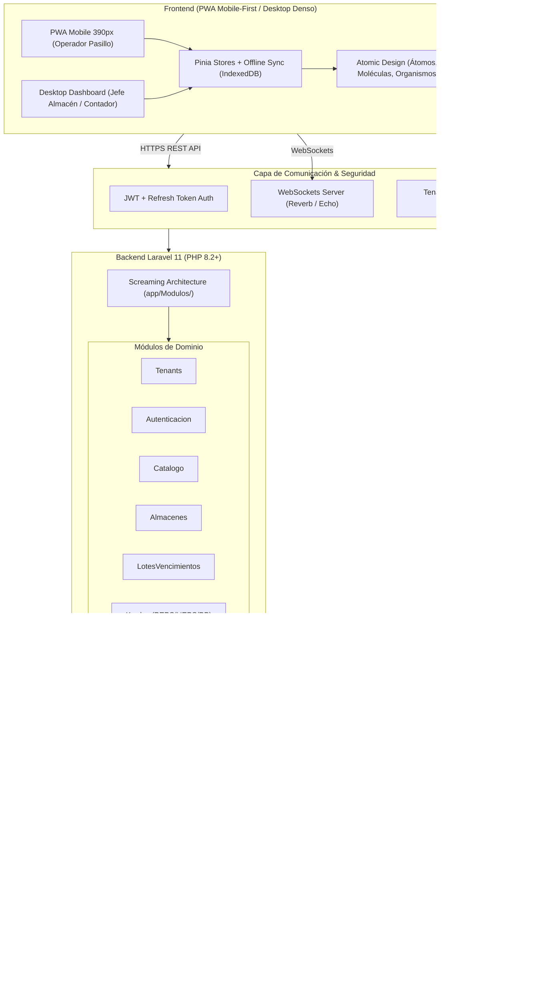

# SGCI — Sistema de Gestión de Control de Inventarios (SaaS Multi-Tenant)

> **Plataforma Enterprise de Control de Inventarios, Kardex Multivaloración y Gestión Operativa de Almacenes Mobile-First.**

[](https://www.php.net/)
[](https://laravel.com/)
[](https://www.postgresql.org/)
[](https://www.prisma.io/)
[](https://vuejs.org/)
[](https://www.typescriptlang.org/)
[](https://tailwindcss.com/)
[](#arquitectura-del-sistema)
[](#paleta-institucional-aurora-mist)

---

## 1. Presentación Ejecutiva y Técnica

**SGCI** es un software como servicio (**SaaS Multi-Tenant**) diseñado para centralizar, automatizar y auditar el ciclo de vida completo de inventarios corporativos en redes multi-almacén y multi-sucursal. Diseñado bajo principios de **alta concurrencia, resiliencia offline y estricto rigor contable**, SGCI unifica la captura operativa en pasillo (mediante PWA móvil con lectores ópticos) con el control estratégico y analítico de costos para la alta gerencia.

### Problemas Críticos que Resuelve

1. **Descontrol de existencias multi-almacén:** Pérdida de visibilidad de inventarios distribuidos en múltiples bodegas, tiendas o depósitos en tránsito.
2. **Quiebres de stock y sobrestock:** Falta de parámetros dinámicos de reorden (stock mínimo, máximo, punto de pedido y stock de seguridad).
3. **Mermas y pérdidas no trazables:** Salidas arbitrarias de mercancía sin justificación, autorización o acta de merma auditable.
4. **Discrepancias entre inventario físico y contable:** Desfase crónico entre el stock reportado por el sistema contable y la existencia real en estantería.
5. **Carencia de valoración de inventarios estandarizada:** Imposibilidad de alternar y auditar métodos de valoración aceptados internacionalmente (**PEPS / FIFO**, **UEPS / LIFO** y **Promedio Ponderado**).
6. **Lentitud e ineficiencia en recepción y despacho:** Procesos manuales en papel, propensos a errores de digitación y sin soporte offline ante caídas de red en almacenes industriales.

---

## 2. Arquitectura Tecnológica Oficial

SGCI implementa una arquitectura desacoplada y orientada al dominio bajo un esquema monorepo estructurado:



### Backend (PHP 8.2+ & Laravel 11)
- **Framework & Runtime:** PHP 8.2+ tipado estricto (`declare(strict_types=1);`), Laravel 11 con estructura optimizada.
- **Screaming Architecture:** El código está organizado por contextos de negocio delimitados dentro de `backend/app/Modulos/` en lugar de la estructura tradicional MVC monolítica.
- **Patrones de Diseño de Dominio:**
  - **Strategy:** Para el motor de costeo y valoración de inventario (`PepsCostingStrategy`, `UepsCostingStrategy`, `PromedioPonderadoCostingStrategy`).
  - **Observer:** Disparo automático de eventos de auditoría y notificaciones reactivas de stock mínimo.
  - **Data Transfer Objects (DTOs):** Inmutabilidad y validación estricta entre capas de transporte y dominio.
  - **Actions / Service Tasks:** Transacciones de negocio atómicas en base de datos (`DB::transaction`).
- **Autenticación & Autorización:** JWT con rotación de Refresh Token, RBAC estricto basado en roles y permisos granulares.
- **WebSockets en Tiempo Real:** Notificaciones instantáneas de variaciones críticas de stock, alertas de lotes por caducar y confirmaciones de despacho.

### Persistencia y Modelado de Datos
- **Motor de Base de Datos:** PostgreSQL 16+.
- **Modelado Dual:** Especificación declarativa unificada en Prisma (`database/prisma/schema.prisma`) como contrato canónico de esquemas relacionales, complementado con modelos Eloquent para la lógica activa en Laravel.
- **Aislamiento Multi-Tenant Estricto:**
  Todas las entidades de persistencia (a excepción del catálogo de tenants globales) implementan obligatoriamente los siguientes metadatos de auditoría y partición:
  - `id`: UUIDv7 / UUIDv4 (Clave Primaria inmutable)
  - `tenant_id`: UUID (Aislamiento de inquilino indexado)
  - `created_at`: Timestamp UTC
  - `updated_at`: Timestamp UTC
  - `deleted_at`: Soft-delete timestamp para preservación de histórico
  - `created_by`: UUID del usuario creador
  - `updated_by`: UUID del usuario modificador
  - *Global Tenant Scope:* Aplicado en Eloquent y replicado en RLS de PostgreSQL para prevenir fugas de datos entre organizaciones.

### Frontend (Vue.js 3 + TypeScript + Pinia + Tailwind CSS + PWA)
- **Stack:** Vue.js 3 (Composition API, `<script setup lang="ts">`), TypeScript 5.x en modo estricto.
- **Arquitectura de Interfaz:** Screaming Architecture (`frontend/src/modulos/`) combinada con **Atomic Design** (`frontend/src/diseno/{atomos,moleculas,organismos}`).
- **PWA Mobile-First:** Diseñada primordialmente para viewports móviles (390px base), optimizada para terminales portátiles rugerizadas y smartphones de bodega:
  - Lectura de códigos de barras (1D: EAN-13, Code 128) y bidimensionales (QR DataMatrix) mediante API nativa de cámara (`BarcodeDetector`) y compatibilidad con escáneres láser HID / USB.
  - Almacenamiento local con IndexedDB para captura offline de conteos físicos y sincronización diferida (Background Sync).
- **Desktop Denso:** Vistas administrativas con tablas densas de alta frecuencia de datos, ordenamiento multicriterio y exportación contable.

### Paleta Institucional Aurora Mist

La interfaz sigue rigurosamente la paleta de diseño **Aurora Mist**, cumpliendo con ratios de contraste WCAG 2.1 nivel AA:

| Nombre de Color | Hexadecimal | Propósito y Uso en SGCI |
| :--- | :---: | :--- |
| **Deep Petrol** | `#203959` | Color primario, barras de navegación, encabezados modales y botones de acción principal. |
| **Slate Blue** | `#416772` | Color secundario, pestañas activas, bordes de enfoque y botones secundarios. |
| **Soft Sage** | `#96ADA5` | Color de acento, estados de éxito, confirmaciones de escaneo y badges informativos. |
| **Mist Gray** | `#ABB7B3` | Color neutro claro, fondos secundarios, divisores y tarjetas inactivas. |
| **Steel Gray** | `#839492` | Texto secundario, bordes estructurales y leyendas de apoyo. |

---

## 3. Matriz de los 10 Roles RBAC de SGCI

SGCI implementa un modelo de Control de Acceso Basado en Roles (**RBAC**) con 10 perfiles claramente delimitados para asegurar la segregación de funciones contables y operativas:

| ID Rol | Nombre Oficial | Alcance y Responsabilidades en el Sistema |
| :---: | :--- | :--- |
| **1** | `super_admin_saas` | **Super Administrador de Plataforma SaaS:** Gestión global de inquilinos (*tenants*), planes de suscripción, asignación de cuotas de almacenamiento y métricas de infraestructura. No interactúa con los datos operativos de cada negocio. |
| **2** | `admin_tenant` | **Administrador General de Empresa/Inquilino:** Configuración integral de la empresa, creación de sucursales/almacenes, definición de la política de valoración por defecto (PEPS/UEPS/Promedio Ponderado) y administración de usuarios y permisos. |
| **3** | `gerente_operaciones` | **Gerente de Operaciones y Cadena de Suministro:** Supervisión de inventario global en toda la red de almacenes, monitoreo de rotación de stock, aprobación de traslados inter-sucursal de gran volumen y control de cuellos de botella. |
| **4** | `jefe_almacen` | **Jefe de Almacén / Bodega:** Responsable técnico de un almacén o centro de distribución específico. Administra zonas, pasillos y racks; autoriza entradas extraordinarias, salidas y actas de merma/deterioro. |
| **5** | `supervisor_inventario` | **Supervisor de Control de Inventarios:** Planificación y calendarización de tomas de inventario físico y conteos cíclicos ciegos; análisis de variaciones de stock y supervisión de alertas FEFO/PEPS. |
| **6** | `almacenista_operador` | **Almacenista / Operador de Recepción y Despacho (PWA):** Uso operativo móvil en pasillos de almacén; escaneo de códigos de barra/QR para recepciones de compras, picking de pedidos, packing, despachos y ejecución de conteos físicos. |
| **7** | `comprador_abastecimiento` | **Especialista de Compras y Reabastecimiento:** Gestión de proveedores, emisión y seguimiento de órdenes de compra (OC), control de alertas por punto de reorden y stock mínimo. |
| **8** | `auditor_inventario` | **Auditor Interno / Conteos Cíclicos y Físicos:** Ejecución de conteos a ciegas en campo sin visibilidad del stock teórico; levantamiento de actas de discrepancia; generación de informes de auditoría sin facultad de ajuste directo. |
| **9** | `contador_costos` | **Contador / Analista de Costos y Kardex Valorizado:** Supervisión del Kardex permanente valorizado; verificación de capas de costo PEPS/UEPS o recálculo ponderado; conciliación fiscal y cierre mensual contable de inventarios. |
| **10** | `visor_consulta` | **Rol de Consulta / Solo Lectura y Reportes:** Visualización pasiva de catálogos, disponibilidad de existencias y reportes generales; sin privilegios de creación, edición o confirmación de movimientos. |

---

## 4. Estructura del Monorepo

```plaintext
C:/dev/SGCI/
├── docs/                                 # Documentación técnica, estrategia y guías de arquitectura
│   └── 01-estrategia-producto-roadmap.md # Estrategia funcional, MoSCoW y Roadmap
├── database/
│   └── prisma/
│       └── schema.prisma                 # Especificación canónica y declarativa del modelo relacional
├── backend/                              # Núcleo API Laravel 11 (PHP 8.2+)
│   ├── app/
│   │   ├── Modulos/                      # Screaming Architecture por dominios de negocio
│   │   │   ├── Tenants/                  # Gestión de inquilinos y configuración global
│   │   │   ├── Autenticacion/            # JWT, sesiones y RBAC
│   │   │   ├── Catalogo/                 # Productos, categorías, UoM y SKUs
│   │   │   ├── Almacenes/                # Bodegas, zonas, racks y transferencias
│   │   │   ├── LotesVencimientos/        # Control de lotes, series y caducidad FEFO
│   │   │   ├── Kardex/                   # Libro diario de inventario y motores de valoración
│   │   │   ├── Compras/                  # Proveedores, OCs y recepciones de mercancía
│   │   │   ├── AuditoriaConteos/         # Tomas físicas, conteos ciegos y conciliaciones
│   │   │   └── AlertasTiempoReal/        # WebSockets y notificaciones push/email
│   │   └── Compartido/                   # DTOs base, Traits Multi-Tenant, Enums globales
│   ├── tests/                            # Batería de pruebas TDD obligatorias
│   │   ├── Feature/                      # Pruebas de integración de endpoints (*Test.php)
│   │   └── Unit/                         # Pruebas unitarias de estrategias y cálculos (*Test.php)
│   └── composer.json
├── frontend/                             # Aplicación Cliente Vue.js 3 + TypeScript + PWA
│   ├── src/
│   │   ├── diseno/                       # Atomic Design
│   │   │   ├── atomos/                   # Botones, inputs, badges Aurora Mist
│   │   │   ├── moleculas/                # Campos de búsqueda, tarjetas de stock, escáneres
│   │   │   └── organismos/               # Tablas densas, modales de conteo, barra de navegación
│   │   ├── modulos/                      # Screaming Architecture Frontend
│   │   │   ├── tenants/
│   │   │   ├── autenticacion/
│   │   │   ├── catalogo/
│   │   │   ├── almacenes/
│   │   │   ├── lotes/
│   │   │   ├── kardex/
│   │   │   ├── compras/
│   │   │   ├── auditoria/
│   │   │   └── alertas/
│   │   └── pruebas/                      # Pruebas TDD Vitest (*.prueba.ts)
│   ├── package.json
│   └── vite.config.ts
├── PRODUCT.md                            # Especificación funcional de producto y principios de UX
└── README.md                             # Este archivo
```

---

## 5. Flujo Git-Flow y Estándar TDD

### Estrategia de Ramas Git-Flow
El ciclo de desarrollo se rige por un esquema Git-Flow estricto:
- `main`: Código productivo, estable y desplegado en infraestructura de producción. Protegido contra commits directos.
- `develop`: Rama principal de integración continua para pruebas de homologación y staging.
- `feat/<modulo>`: Ramas de características individuales derivadas de `develop`. Ejemplo:
  - `feat/tenants-auth`
  - `feat/catalogo-almacenes`
  - `feat/lotes-vencimientos`
  - `feat/kardex-valoracion`
  - `feat/compras-recepcion`
  - `feat/auditoria-conteos-pwa`
  - `feat/alertas-websockets`

### Estándar TDD Obligatorio
Todo componente, servicio, endpoint o estrategia debe desarrollarse siguiendo el ciclo **Red-Green-Refactor**:
- **Backend (PHPUnit / Pest):**
  - Toda suite de prueba se nombrará con el sufijo `*Test.php`.
  - Cobertura mínima obligatoria en servicios de costeo (PEPS/UEPS/Ponderado) y validaciones de tenant: **95%**.
- **Frontend (Vitest + Vue Test Utils):**
  - Toda prueba unitaria y de componente se nombrará con el sufijo `*.prueba.ts`.
  - Cobertura rigurosa en almacenamiento local offline (IndexedDB), parseo de códigos de barras y resolución de discrepancias.

---

## 6. Documentos del Proyecto y Ejecución en Vivo del MVP (`v1.12.0-MVP`)

- [Acta de Entrega del MVP y Guion de Pruebas UAT (docs/13-entrega-mvp-guia-pruebas-uat.md)](file:///C:/dev/SGCI/docs/13-entrega-mvp-guia-pruebas-uat.md)
- [Checklist Ejecutivo de Validación del MVP para Stakeholders (docs/14-checklist-ejecutivo-validacion-mvp.md)](file:///C:/dev/SGCI/docs/14-checklist-ejecutivo-validacion-mvp.md)
- [Auditoría de Cierre SOLID & Screaming Architecture (docs/10-auditoria-cierre-fase2-uat-mvp.md)](file:///C:/dev/SGCI/docs/10-auditoria-cierre-fase2-uat-mvp.md)
- [Auditoría de Seguridad OWASP & Multi-Tenant (docs/06-auditoria-seguridad-multitenant.md)](file:///C:/dev/SGCI/docs/06-auditoria-seguridad-multitenant.md)
- [Cierre Integral Fase III — 47 Pantallas Oficiales SGCI y Brechas LEEME.txt (docs/12-cierre-integral-fase-3-pantallas-sgci.md)](file:///C:/dev/SGCI/docs/12-cierre-integral-fase-3-pantallas-sgci.md)
- [Especificación Operativa de Producto (PRODUCT.md)](file:///C:/dev/SGCI/PRODUCT.md)
- [Arquitectura del Sistema y ADRs (docs/02-arquitectura-sistema-adr.md)](file:///C:/dev/SGCI/docs/02-arquitectura-sistema-adr.md)

### Comandos de Verificación TDD, E2E y Lanzador de 1 Clic del MVP
```powershell
# Opción A: Lanzador automático de 1 clic en Windows (Ejecuta pruebas + levanta servidor + abre navegador)
C:\dev\SGCI\INICIAR-MVP-PRUEBA.bat

# Opción B: Ejecución manual por consola
# 1. Ejecutar Suite TDD Backend (12 Suites · 40/40 pruebas en verde)
php C:\dev\SGCI\backend\scripts\ejecutar-pruebas-tdd.php

# 2. Ejecutar Suite TDD Frontend (12 Suites · 32/32 pruebas en verde)
node C:\dev\SGCI\frontend\scripts\ejecutar-pruebas-frontend.mjs

# 3. Levantar Portal Interactivo MVP SGCI con las 47 pantallas oficiales y API v1 (http://127.0.0.1:4173)
node C:\dev\SGCI\scripts\servidor-sgci.mjs

# 4. Ejecutar Verificador E2E contra el servidor en vivo
node C:\dev\SGCI\scripts\probar-api-mvp-vivo.mjs
```
