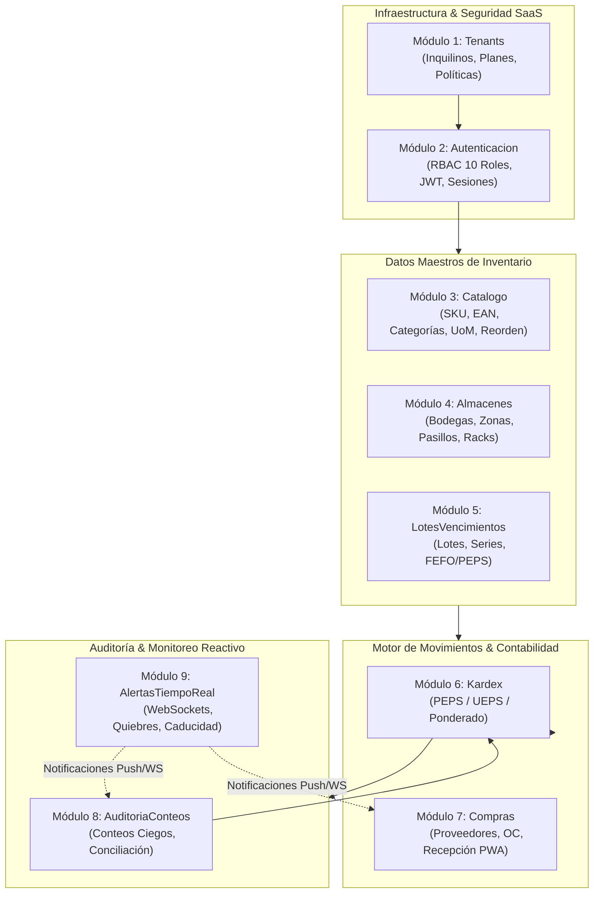
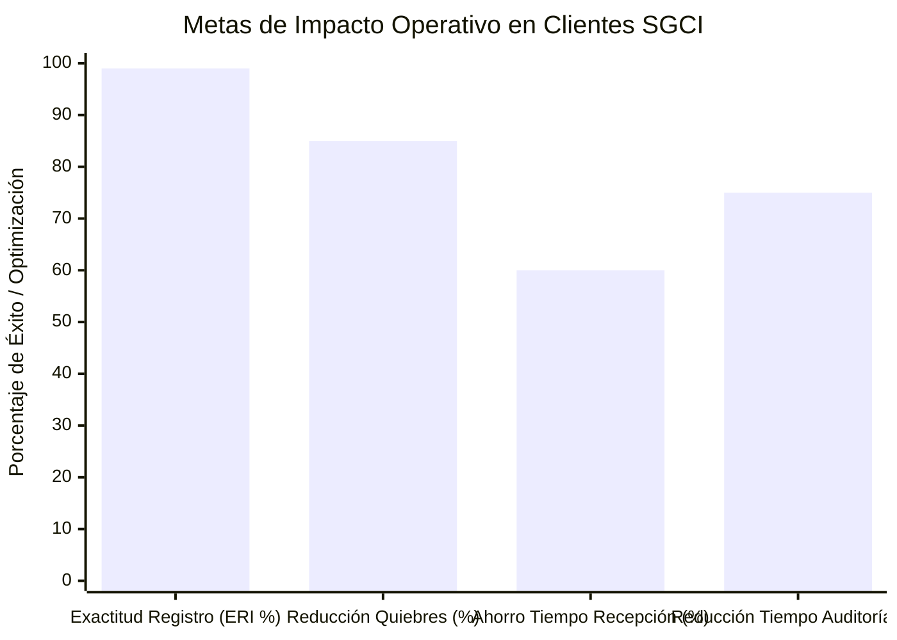

# SGCI — Estrategia de Producto, Arquitectura Funcional y Hoja de Ruta

> **Plan Maestro de Dominio, Catálogo de Módulos (Screaming Architecture), Priorización MoSCoW y Roadmap de Sprints.**

---

## 1. Catálogo de Módulos de Negocio (Screaming Architecture)

La arquitectura de SGCI está organizada bajo el principio de **Screaming Architecture**, donde los directorios y límites de código reflejan de manera explícita los conceptos y procesos del negocio de control de inventarios.



---

### Módulo 1: `Tenants` (Gestión de Inquilinos y Configuración Global)
- **Propósito:** Proporcionar aislamiento lógico total entre empresas suscriptoras del SaaS, gobernanza de suscripciones y configuración contable personalizada.
- **Entidades Principales:** `Tenant`, `TenantConfiguracion`, `TenantSuscripcion`, `TenantMetodoCosteo`.
- **Funcionalidades Clave:**
  - Registro, aprovisionamiento y ciclo de vida de organizaciones (alta, suspensión, reactivación, baja).
  - Parámetros contables por defecto: Selección del método de valoración canónico (**PEPS / FIFO**, **UEPS / LIFO**, o **Promedio Ponderado**).
  - Configuración de políticas de stock negativo (estricto / con tolerancia temporal auditada).
  - Cuotas de almacenamiento de documentos adjuntos, límites de usuarios concurrentes y límites de almacenes creados.

---

### Módulo 2: `Autenticacion` (Identidad, Sesiones y RBAC de 10 Roles)
- **Propósito:** Garantizar el acceso seguro, trazable y segregado a la plataforma mediante tokens criptográficos y control granular de permisos.
- **Entidades Principales:** `Usuario`, `Rol`, `Permiso`, `UsuarioRol`, `SesionDispositivo`, `RefreshToken`.
- **Funcionalidades Clave:**
  - Autenticación mediante **JWT** (JSON Web Tokens) de corta duración (15-30 min) y rotación segura de **Refresh Tokens** persistidos con huella de dispositivo.
  - Implementación de la matriz completa de **10 Roles RBAC**:
    1. `super_admin_saas`
    2. `admin_tenant`
    3. `gerente_operaciones`
    4. `jefe_almacen`
    5. `supervisor_inventario`
    6. `almacenista_operador`
    7. `comprador_abastecimiento`
    8. `auditor_inventario`
    9. `contador_costos`
    10. `visor_consulta`
  - Restricción de acceso por almacén asignado para roles operativos de bodega.

---

### Módulo 3: `Catalogo` (Productos, Unidades, Puntos de Reorden)
- **Propósito:** Administrar la biblioteca maestra de artículos, jerarquías comerciales y umbrales de reabastecimiento continuo.
- **Entidades Principales:** `Producto`, `Categoria`, `UnidadMedida`, `ConversionUnidad`, `ProductoCodigoBarras`.
- **Funcionalidades Clave:**
  - Gestión de identificadores: SKU interno, códigos universales EAN-13 / UPC, y códigos bidimensionales QR.
  - Tablas de conversión de unidades de medida (ej. pallets $\rightarrow$ cajas $\rightarrow$ piezas unitarias).
  - Parámetros de inventario por almacén:
    - **Stock Mínimo:** Nivel umbral que dispara la solicitud de compra automática.
    - **Stock Máximo:** Límite superior para evitar sobrecostos de almacenamiento.
    - **Punto de Reorden (ROP):** Momento exacto de emisión de orden considerando el Lead Time del proveedor.
    - **Stock Crítico (Seguridad):** Nivel de alerta roja inmediata para compras prioritarias.

---

### Módulo 4: `Almacenes` (Estructura Topológica y Transferencias)
- **Propósito:** Modelar la topología física de almacenamiento y orquestar el flujo de mercancía entre dependencias corporativas.
- **Entidades Principales:** `Almacen`, `Zona`, `Pasillo`, `UbicacionRack` (Bin Location), `TransferenciaAlmacen`, `TransferenciaDetalle`.
- **Funcionalidades Clave:**
  - Jerarquía espacial estandarizada: Sucursal $\rightarrow$ Almacén $\rightarrow$ Zona (Seca, Fría, Peligrosa) $\rightarrow$ Pasillo $\rightarrow$ Rack $\rightarrow$ Nivel $\rightarrow$ Posición (*Bin*).
  - Transferencias inter-almacenes con doble verificación:
    1. *Despacho en origen:* El stock pasa a estado lógico de "En Tránsito".
    2. *Recepción en destino:* El operador de destino escanea y confirma bultos; el stock se acredita formalmente en el almacén de llegada o se levanta acta de discrepancia en tránsito.

---

### Módulo 5: `LotesVencimientos` (Trazabilidad Sanitaria y Caducidad)
- **Propósito:** Controlar la trazabilidad profunda por lote de producción, fechas de caducidad y números de serie unitarios.
- **Entidades Principales:** `Lote`, `NumeroSerie`, `EstadoLote`, `TrazabilidadLote`.
- **Funcionalidades Clave:**
  - Atributos por lote: Número de lote del fabricante, fecha de fabricación, fecha de caducidad, fecha límite de venta.
  - Estrategia de despacho **FEFO (First Expired, First Out)**: El sistema instruye al operador en PWA a recoger primero el lote con fecha de caducidad más cercana, reduciendo mermas por vencimiento a cero.
  - Gestión de estados de lote: *Disponible*, *En Cuarentena*, *Vencido*, *Retenido por Calidad*.

---

### Módulo 6: `Kardex` (Libro Diario de Inventario y Multivaloración)
- **Propósito:** Registrar de forma inmutable todas las transacciones de inventario y calcular el valor patrimonial de las existencias según el método de costeo elegido.
- **Entidades Principales:** `KardexMovimiento`, `KardexCapaCosto`, `TipoMovimiento`, `CierreMensualInventario`.
- **Funcionalidades Clave:**
  - Registro de movimientos con granularidad de auditoría: Entradas (compras, donaciones), Salidas (ventas, mermas), Ajustes (positivos, negativos), Traslados y Reclasificaciones.
  - **Patrón Strategy de Valoración Contable:**
    - `PEPS (FIFO)`: Las primeras unidades en entrar son las primeras en salir. Las existencias finales quedan valoradas a los costos de adquisición más recientes.
    - `UEPS (LIFO)`: Las últimas unidades en entrar son las primeras en salir. Útil para entornos de alta inflación donde el costo de venta debe reflejar el valor de reposición actual.
    - `Promedio Ponderado`: Recálculo dinámico del costo unitario promedio tras cada recepción de compra con precio unitario variable.
  - Bloqueo y cierre contable mensual con congelamiento de saldos históricos.

---

### Módulo 7: `Compras` (Proveedores, Órdenes y Recepción PWA)
- **Propósito:** Administrar el aprovisionamiento de mercancía y contrastar las órdenes contra la entrega física real en muelle de carga.
- **Entidades Principales:** `Proveedor`, `OrdenCompra`, `OrdenCompraItem`, `RecepcionMercancia`, `RecepcionItem`, `ActaDiscrepancia`.
- **Funcionalidades Clave:**
  - Emisión de Órdenes de Compra con asignación de precios pactados e impuestos.
  - Recepción de mercancía en muelle con terminal PWA móvil:
    - Escaneo guiado contra la Orden de Compra abierta.
    - Recepciones parciales toleradas con actualización del saldo pendiente.
    - Emisión instantánea de Acta de Conformidad o Acta de Discrepancia (productos dañados, faltantes o no solicitados).

---

### Módulo 8: `AuditoriaConteos` (Tomas Físicas, Conteos Ciegos y Conciliación)
- **Propósito:** Ejecutar procesos de auditoría y tomas físicas de inventario para detectar y corregir desviaciones entre el stock físico y el teórico.
- **Entidades Principales:** `TomaFisica`, `ConteoCiclico`, `ConteoItem`, `DiscrepanciaConteo`, `ActaAjusteInventario`.
- **Funcionalidades Clave:**
  - **Conteos Cíclicos Ciegos:** La PWA presenta al auditor la lista de ubicaciones a verificar pero **oculta la cantidad teórica en el sistema**, forzando un recuento honesto y libre de sesgos.
  - Algoritmo de conciliación automática: Comparación instantánea del conteo físico con el saldo del sistema.
  - Flujo de doble aprobación para ajustes de inventario: Discrepancias monetarias por encima del umbral configurado requieren aprobación mancomunada del `jefe_almacen` y del `contador_costos`.

---

### Módulo 9: `AlertasTiempoReal` (Notificaciones Reactivas WebSockets)
- **Propósito:** Mantener informados a los responsables operativos y gerenciales ante eventos críticos de inventario en tiempo real.
- **Entidades Principales:** `Alerta`, `CanalNotificacion`, `ReglaAlerta`, `SuscripcionAlerta`.
- **Funcionalidades Clave:**
  - Conexión persistente WebSockets mediante Laravel Reverb / WebSockets Server.
  - Disparadores automáticos:
    - Stock cae por debajo del nivel mínimo o crítico.
    - Lote a 30 / 15 / 7 días de vencer sin orden de salida generada.
    - Detección de discrepancia grave en recepción o conteo físico.
    - Recepción de compra en muelle confirmada por el operador.

---

## 2. Priorización MoSCoW (Alcance MVP vs Fases Siguientes)

```mermaid
quadrantChart
    title Priorización MoSCoW - SGCI
    x-axis Urgencia Operativa Baja --> Urgencia Operativa Alta
    y-axis Valor Contable & Negocio Bajo --> Valor Contable & Negocio Alto
    quadrant-1 Must Have (Crítico MVP)
    quadrant-2 Should Have (Alto Valor)
    quadrant-3 Won't Have (Fuera de MVP)
    quadrant-4 Could Have (Deseable)
    "Kardex Inmutable PEPS/UEPS/PP": [0.95, 0.95]
    "PWA Escaneo Mobile Recepción": [0.90, 0.90]
    "Multi-Tenant Estricto UUID": [0.85, 0.92]
    "RBAC 10 Roles Granular": [0.88, 0.85]
    "Catálogo SKUs y Puntos Reorden": [0.92, 0.80]
    "Auditoría Conteos Ciegos PWA": [0.80, 0.88]
    "Lotes y Caducidad FEFO": [0.75, 0.78]
    "WebSockets Alertas Tiempo Real": [0.70, 0.72]
    "Transferencias Inter-Almacén": [0.65, 0.68]
    "Cierre Mensual Contable": [0.60, 0.75]
    "Exportaciones Masivas Excel/PDF": [0.45, 0.50]
    "Reabastecimiento Sugerido IA": [0.30, 0.40]
    "Manufactura y BOM Multinivel": [0.15, 0.20]
    "Ruteo de Flotas Logísticas TMS": [0.10, 0.15]
    "Facturación Fiscal Directa": [0.20, 0.25]
```

### Must Have (Obligatorio en MVP)
- Aislamiento Multi-Tenant estricto por `tenant_id` (UUID) en todas las entidades.
- Sistema de autenticación JWT + rotación de Refresh Tokens y RBAC con los 10 roles configurados.
- Catálogo maestro de productos con soporte para SKU, códigos de barra EAN-13 y QR.
- Estructura de almacenes, zonas y ubicaciones tipo rack (*Bin Location*).
- Control de lotes y fechas de vencimiento con despacho prioritario FEFO.
- Kardex inmutable con motor de costeo multi-estrategia (**PEPS**, **UEPS**, **Promedio Ponderado**).
- Órdenes de compra y recepción de mercancía mediante PWA Mobile-First con lectura óptica de códigos.
- Módulo de auditoría con conteos cíclicos ciegos y conciliación automática.
- Resiliencia PWA ante pérdida de conectividad Wi-Fi con sincronización en segundo plano.

### Should Have (Importante para Estabilidad y Operación Fluida)
- Notificaciones WebSockets en tiempo real por quiebre de stock y lotes próximos a vencer.
- Guías de transferencia inter-almacén con estado intermedio "En Tránsito".
- Generación e impresión de etiquetas con códigos QR y barras en formato estándar para impresoras térmicas (Zebra / ZPL / PDF).
- Cierre formal mensual de inventarios con bloqueo de periodos.

### Could Have (Deseable si el cronograma lo permite)
- Sugerencia automatizada de cantidad óptima de compra basada en velocidad histórica de consumo (Lead Time x Demanda Promedio).
- Reportes gráficos avanzados de rotación de inventario (Índice de Rotación y Días de Inventario en Calle).
- Envío de notificaciones críticas vía webhook a canales de Slack / Microsoft Teams.

### Won't Have (Fuera del Alcance del MVP)
- Módulo MRP de manufactura con explosión de materiales (BOM).
- Sistema de ruteo y seguimiento GPS de transportes (TMS).
- Facturación fiscal electrónica directa de cada país.
- Terminales de punto de venta minorista (POS).

---

## 3. Hoja de Ruta de Sprints (Roadmap Técnico)

El desarrollo se organiza en sprints de 2 semanas de duración bajo la disciplina Git-Flow, garantizando cobertura TDD desde la primera línea de código:

| Sprint | Enfoque Principal | Módulos Impactados | Rama Git-Flow | Entregables Clave |
| :---: | :--- | :--- | :--- | :--- |
| **Sprint 1** | Cimientos Multi-Tenant, Base de Datos y Seguridad | `Tenants`, `Autenticacion` | `feat/tenants-auth` | - Migraciones y esquemas Prisma con `tenant_id` y metadatos de auditoría.<br>- JWT + Refresh Tokens.<br>- Middleware RBAC con 10 roles.<br>- UI de login y cambio de contraseña con paleta Aurora Mist. |
| **Sprint 2** | Catálogo de Productos y Topología de Almacenes | `Catalogo`, `Almacenes` | `feat/catalogo-almacenes` | - Maestro de productos, SKUs, EANs y QR.<br>- Definición de unidades de medida y factores de conversión.<br>- Estructura de bodegas, zonas y ubicaciones bin-location.<br>- Algoritmo de validación de códigos de barra. |
| **Sprint 3** | Trazabilidad de Lotes, Series y Vencimientos | `LotesVencimientos` | `feat/lotes-vencimientos` | - Registro de lotes y series por producto.<br>- Reglas de cuarentena automática.<br>- Algoritmo de sugerencia de despacho FEFO (caducidad más cercana).<br>- Semáforo visual de caducidad en UI Aurora Mist. |
| **Sprint 4** | Motor Central de Kardex y Estrategias de Costeo | `Kardex` | `feat/kardex-valoracion` | - Implementación de `PepsCostingStrategy`, `UepsCostingStrategy` y `PromedioPonderadoCostingStrategy`.<br>- Trazabilidad inmutable de movimientos append-only.<br>- Generador de balance de comprobación de inventario.<br>- Pruebas unitarias de cálculo con cobertura > 95%. |
| **Sprint 5** | Cadena de Compras y Recepción Móvil PWA | `Compras` | `feat/compras-recepcion` | - Gestión de proveedores y órdenes de compra.<br>- Interfaz PWA Mobile-First (390px) para recepción en muelle.<br>- Lectura de códigos con cámara y escáner láser.<br>- Generación de actas de discrepancia de entrega. |
| **Sprint 6** | Auditoría, Conteos Cíclicos Offline y Ajustes | `AuditoriaConteos` | `feat/auditoria-conteos-pwa` | - Planificador de tomas físicas y conteos ciegos.<br>- Almacenamiento local IndexedDB para conteo sin conexión Wi-Fi.<br>- Background Sync determinista al recuperar conexión.<br>- Flujo de autorización mancomunada de ajustes. |
| **Sprint 7** | WebSockets en Tiempo Real, Alertas y Reportes | `AlertasTiempoReal`, `Compartido` | `feat/alertas-websockets-reportes` | - Servidor de WebSockets integrado.<br>- Alertas push/toast en vivo por stock crítico.<br>- Reportes densos para Desktop con exportación a Excel y PDF.<br>- Auditoría de rendimiento y pruebas de carga multi-inquilino. |

---

## 4. Métricas de Éxito y KPIs Operacionales

La efectividad operativa y técnica de SGCI en cada organización inquilina se evaluará mediante los siguientes indicadores clave:



1. **Exactitud de Registro de Inventario (ERI / Record Accuracy):**
   - **Meta:** $> 99.2\%$.
   - **Fórmula:** $(\text{Unidades Físicas Conciliadas Sin Discrepancia} / \text{Unidades Totales Contadas}) \times 100$.
2. **Reducción de Quiebres de Stock (Stockouts):**
   - **Meta:** Reducción de al menos un **$85\%$** en eventos de desabastecimiento no planificado gracias a las alertas reactivas de punto de reorden (ROP).
3. **Tiempo de Ciclo de Recepción en Muelle:**
   - **Meta:** Reducción del **$60\%$** en el tiempo de procesamiento de descargas de camión, pasando de hojas físicas manuales al escaneo en 2 toques con PWA.
4. **Tiempo de Ejecución y Conciliación de Auditorías:**
   - **Meta:** Disminución del **$75\%$** en el tiempo empleado para cerrar inventarios físicos mensuales, pasando de días a pocas horas con sincronización offline-to-cloud.
5. **Cero Saldo Descuadrado Contable-Físico:**
   - **Meta:** $100\%$ de paridad entre el saldo monetario del Kardex valorizado y los libros mayores contables de la organización al cierre de cada periodo fiscal.

---

## 5. Enlaces y Referencias de Arquitectura

- [README Principal de SGCI](file:///C:/dev/SGCI/README.md)
- [Especificación Operativa de Producto (PRODUCT.md)](file:///C:/dev/SGCI/PRODUCT.md)
