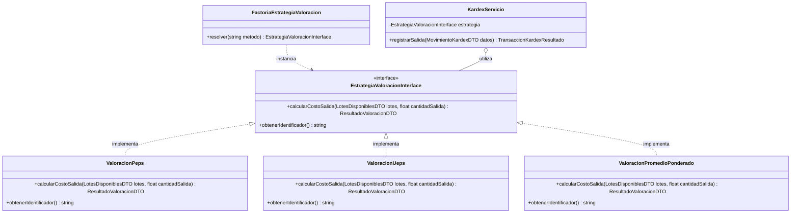
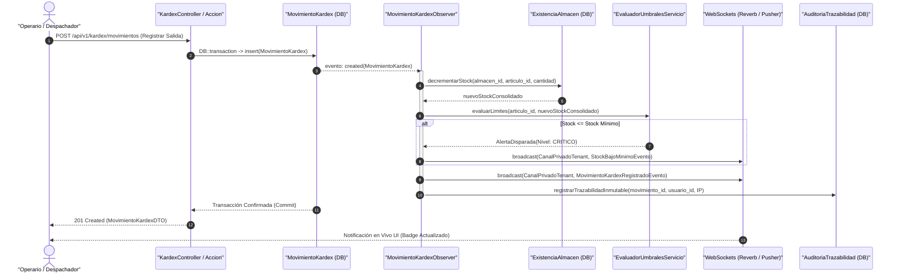
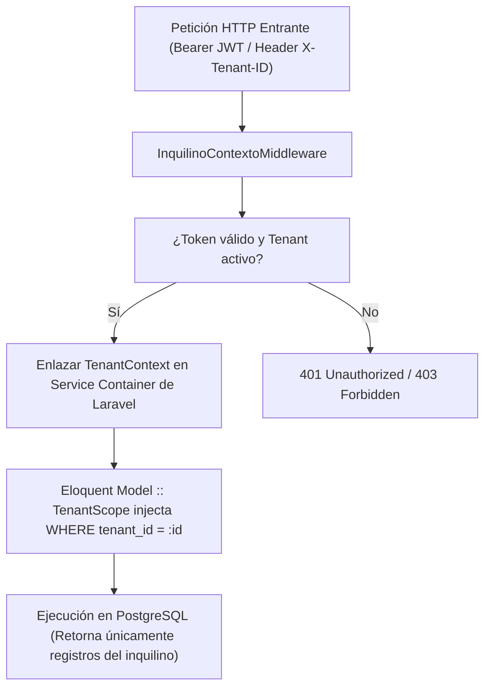

# Especificación de Arquitectura de Software y Registro de Decisiones (ADRs)
## SGCI — Sistema de Gestión de Control de Inventarios (SaaS Multi-Tenant)

- **Identificador del Documento:** `SGCI-DOC-002`
- **Versión:** `1.0.0`
- **Estado:** `Aprobado / Línea Base`
- **Autor Principal:** `system-architect`
- **Fecha de Emisión:** 2026-10-29
- **Repositorio Central:** [C:/dev/SGCI](file:///C:/dev/SGCI)
- **Protocolo de Agentes:** [AGENTS.md](file:///C:/dev/SGCI/AGENTS.md)

---

## Índice de Contenidos
1. [Visión General del Sistema y Atributos de Calidad](#1-visión-general-del-sistema-y-atributos-de-calidad)
2. [Diagrama General de Arquitectura](#2-diagrama-general-de-arquitectura)
3. [Screaming Architecture (Arquitectura Orientada al Dominio)](#3-screaming-architecture-arquitectura-orientada-al-dominio)
   - 3.1. [Estructura del Backend (Laravel 11 / PHP 8.2+)](#31-estructura-del-backend-laravel-11--php-82)
   - 3.2. [Estructura del Frontend (Vue 3 / TypeScript / Pinia)](#32-estructura-del-frontend-vue-3--typescript--pinia)
   - 3.3. [Atomic Design y Sistema de Color Aurora Mist](#33-atomic-design-y-sistema-de-color-aurora-mist)
4. [Principios SOLID y Patrones de Diseño Aplicados](#4-principios-solid-y-patrones-de-diseño-aplicados)
   - 4.1. [Patrón Strategy: Valoración de Inventario en Kardex](#41-patrón-strategy-valoración-de-inventario-en-kardex)
   - 4.2. [Patrón Observer: MovimientoKardexObserver y WebSockets](#42-patrón-observer-movimientokardexobserver-y-websockets)
   - 4.3. [Patrón DTO (Data Transfer Objects Inmutables)](#43-patrón-dto-data-transfer-objects-inmutables)
5. [Arquitectura de Seguridad, Multi-Tenant y RBAC](#5-arquitectura-de-seguridad-multi-tenant-y-rbac)
   - 5.1. [Aislamiento Multi-Tenant (TenantScope + Middleware)](#51-aislamiento-multi-tenant-tenantscope--middleware)
   - 5.2. [Autenticación JWT con Refresh Token y Rotación Criptográfica](#52-autenticación-jwt-con-refresh-token-y-rotación-criptográfica)
   - 5.3. [Matriz Técnica de Permisos de los 10 Roles RBAC](#53-matriz-técnica-de-permisos-de-los-10-roles-rbac)
6. [Catálogo de Registros de Decisiones de Arquitectura (ADRs)](#6-catálogo-de-registros-de-decisiones-de-arquitectura-adrs)
   - [ADR-001: Screaming Architecture y Monorepo Modular](#adr-001-adopción-de-screaming-architecture-y-monorepo-modular-laravel-11--vue-3)
   - [ADR-002: Aislamiento Multi-Tenant por Clave Particionada (UUID)](#adr-002-aislamiento-multi-tenant-en-base-de-datos-compartida-mediante-tenant_id-uuid-y-auditoría-estándar)
   - [ADR-003: Especificación Declarativa Dual (Prisma + Eloquent)](#adr-003-especificación-declarativa-dual-con-prisma-schemaprisma-y-eloquent-orm-sobre-postgresql)
   - [ADR-004: Inmutabilidad de Kardex y Estrategias PEPS/UEPS/CPP](#adr-004-inmutabilidad-del-libro-mayor-de-inventario-kardex-y-patrón-strategy-para-valoración-peps-ueps-cpp)
   - [ADR-005: Sincronización PWA Offline-First y Alertas WebSockets](#adr-005-sincronización-pwa-offline-first-para-conteos-físicos-y-recepción-en-bodega--alertas-websockets)
   - [ADR-006: Atomic Design con Paleta Institucional Aurora Mist](#adr-006-sistema-de-diseño-atomic-design-con-paleta-oficial-aurora-mist)

---

## 1. Visión General del Sistema y Atributos de Calidad

El **SGCI** es un software empresarial como servicio (SaaS) multinquilino diseñado para gestionar el ciclo de vida integral de existencias en tiempo real. Resuelve la complejidad operativa de almacenes distribuidos, bodegas logísticas, centros de distribución y puntos de venta.

### Atributos de Calidad Primarios:
1. **Integridad Transaccional y Contable:** El inventario se gestiona como un Libro Mayor inmutable (Kardex). No existen eliminaciones ni ediciones físicas sobre movimientos contables consolidados. Las correcciones se efectúan mediante asientos de contrapartida o ajustes autorizados.
2. **Aislamiento Estricto de Datos (Multi-Tenancy):** Cada empresa o cliente opera con aislamiento lógico reforzado en base de datos PostgreSQL compartida mediante la clave de partición `tenant_id` (UUID), resguardada por scopes globales transparentes a nivel de ORM.
3. **Escalabilidad y Concurrencia:** Arquitectura desacoplada, colas asíncronas para procesamiento de auditoría y WebSockets para difusión de alertas críticas sin bloqueo de hilos de ejecución de la API.
4. **Resiliencia Operativa Offline-First:** Los operarios de bodega ejecutan conteos físicos cíclicos y recepciones en zonas de sombra o sin conectividad WiFi/4G, sincronizando paquetes de datos atómicos tan pronto como se reanuda la conexión.

---

## 2. Diagrama General de Arquitectura

El siguiente diagrama detalla la interacción entre capas físicas y lógicas del sistema SGCI:

```mermaid
flowchart TD
    subgraph ClientePWA["Cliente Frontend (PWA Mobile-First / Web)"]
        UI["Vue 3 + Tailwind CSS (Atomic Design)"]
        PiniaStore["Pinia Stores (Estado Local)"]
        SW["Service Worker (Workbox + IndexedDB Offline)"]
        WSClient["Echo / Reverb WebSockets Client"]
    end

    subgraph Gateway["Capa de Red y Entrada"]
        Nginx["Reverse Proxy (Nginx / SSL)"]
        WSServer["Servidor WebSockets (Laravel Reverb / Soketi)"]
    end

    subgraph BackendAPI["Backend Core (Laravel 11 / PHP 8.2+)"]
        MWTenant["InquilinoContextoMiddleware (Tenant Context)"]
        MWRBAC["AutenticacionRBACMiddleware (JWT + Roles)"]
        
        subgraph ModulosScreaming["Screaming Architecture (backend/app/Modulos/)"]
            M_Tenants["Tenants"]
            M_Auth["Autenticacion"]
            M_Cat["Catalogo"]
            M_Alm["Almacenes"]
            M_Lot["LotesVencimientos"]
            M_Kardex["Kardex (Strategy PEPS/UEPS/CPP)"]
            M_Comp["Compras"]
            M_Cont["AuditoriaConteos"]
            M_Alert["AlertasTiempoReal"]
        end

        ObserverKardex["MovimientoKardexObserver"]
        EventDispatcher["Event Dispatcher & Jobs"]
    end

    subgraph Persistencia["Capa de Persistencia y Caché"]
        PG[("PostgreSQL 16 (Multi-Tenant RLS / Tablas Particionadas)")]
        RedisDB[("Redis (Caché, Colas y Pub/Sub WebSockets)")]
    end

    UI --> PiniaStore
    PiniaStore --> SW
    PiniaStore --> WSClient
    SW -->|HTTP REST / JSON| Nginx
    WSClient <-->|Canales Privados WSS| WSServer

    Nginx --> MWTenant
    MWTenant --> MWRBAC
    MWRBAC --> ModulosScreaming

    M_Kardex --> ObserverKardex
    ObserverKardex --> EventDispatcher
    EventDispatcher -->|Broadcast Event| WSServer
    EventDispatcher -->|Push Async Job| RedisDB

    ModulosScreaming -->|Eloquent ORM (TenantScope)| PG
    ModulosScreaming -->|Caché de Permisos y Sesión| RedisDB
```

---

## 3. Screaming Architecture (Arquitectura Orientada al Dominio)

La arquitectura de SGCI no gira alrededor del framework (Laravel o Vue), sino alrededor del **negocio de inventarios y logística**. Las carpetas gritan la intención del sistema.

### 3.1. Estructura del Backend (`backend/app/Modulos/`)
Ubicación base: [backend/app/Modulos/](file:///C:/dev/SGCI/backend/app/Modulos)

```
backend/app/Modulos/
├── Tenants/
│   ├── Acciones/           # CrearInquilinoAccion, ConfigurarParametrosTenantAccion
│   ├── Modelos/            # Inquilino, DominioInquilino, Membresia
│   └── Servicios/          # InquilinoContextoServicio
├── Autenticacion/
│   ├── Acciones/           # LoginUsuarioAccion, RefrescarTokenAccion, RevocarSesionAccion
│   ├── DTOs/               # CredencialesDTO, TokenPayloadDTO, SesionActivaDTO
│   ├── Modelos/            # Usuario, Rol, Permiso, TokenRefresco
│   ├── Politicas/          # PoliticaBaseRBAC, UsuarioPolitica
│   └── Servicios/          # JwtManejadorServicio, RbacServicio
├── Catalogo/
│   ├── Acciones/           # RegistrarArticuloAccion, ActualizarPreciosAccion
│   ├── DTOs/               # ArticuloCreacionDTO, ArticuloFiltroDTO
│   ├── Modelos/            # Articulo, Categoria, Marca, UnidadMedida, FactorConversion
│   └── Servicios/          # CodigoBarraGeneradorServicio, ConversorUnidadesServicio
├── Almacenes/
│   ├── Acciones/           # CrearAlmacenAccion, TransferirStockEntreAlmacenesAccion
│   ├── DTOs/               # TransferenciaInternaDTO, UbicacionBinDTO
│   ├── Modelos/            # Almacen, ZonaAlmacenaje, Pasillo, Estante, UbicacionBin, ExistenciaAlmacen
│   └── Servicios/          # CapacidadAlmacenServicio, RuteoPickingServicio
├── LotesVencimientos/
│   ├── Acciones/           # IngresarLoteAccion, PonerEnCuarentenaLoteAccion
│   ├── DTOs/               # LoteIngresoDTO, LoteEstadoDTO
│   ├── Modelos/            # Lote, TrazaLote, CuarentenaRegistro
│   └── Servicios/          # SemaforoVencimientoServicio, ReglaFefoServicio
├── Kardex/
│   ├── Acciones/           # RegistrarMovimientoKardexAccion, ReconstruirSaldosKardexAccion
│   ├── DTOs/               # MovimientoKardexDTO, SaldoConsolidadoDTO, ResultadoValoracionDTO
│   ├── Modelos/            # MovimientoKardex, TipoMovimientoKardex, CapaCostoLote
│   ├── Observadores/       # MovimientoKardexObserver
│   └── Servicios/
│       ├── Estrategias/    # EstrategiaValoracionInterface, ValoracionPeps, ValoracionUeps, ValoracionPromedioPonderado
│       └── KardexServicio  # Orquestador del libro mayor
├── Compras/
│   ├── Acciones/           # GenerarOrdenCompraAccion, RecibirMercaderiaAccion
│   ├── DTOs/               # OrdenCompraDTO, RecepcionFisicaDTO
│   ├── Modelos/            # Proveedor, OrdenCompra, DetalleOrdenCompra, RecepcionMercaderia
│   └── Servicios/          # CotejoRecepcionFacturaServicio
├── AuditoriaConteos/
│   ├── Acciones/           # IniciarConteoCiclicoAccion, ConciliarDiscrepanciasAccion
│   ├── DTOs/               # RegistroConteoFisicoDTO, DiscrepanciaAjusteDTO
│   ├── Modelos/            # ConteoCiclico, DetalleConteo, ActaAjusteInventario
│   └── Servicios/          # AlgoritmoAnalisisAbcServicio, ConciliacionCiegaServicio
└── AlertasTiempoReal/
    ├── Eventos/            # StockBajoMinimoEvento, StockExcedidoMaximoEvento, LotePorVencerEvento
    ├── DTOs/               # NotificacionAlertaDTO
    ├── Modelos/            # ReglaAlerta, BitacoraAlerta
    └── Servicios/          # NotificadorWebSocketsServicio, EvaluadorUmbralesServicio
```

### 3.2. Estructura del Frontend (`frontend/src/`)
Ubicación base: [frontend/src/](file:///C:/dev/SGCI/frontend/src)

```
frontend/src/
├── diseno/                             # Atomic Design y Primitivas UI
│   ├── atomos/                         # Componentes atómicos indivisibles
│   │   ├── AuroraBoton.vue
│   │   ├── AuroraInput.vue
│   │   ├── AuroraBadgeEstado.vue
│   │   ├── AuroraIcono.vue
│   │   └── AuroraSpinner.vue
│   ├── moleculas/                      # Agrupaciones de átomos con propósito funcional
│   │   ├── BuscadorArticuloBarra.vue
│   │   ├── CampoConteoConEan.vue
│   │   ├── TarjetaMétricaKpi.vue
│   │   ├── SelectorUbicacionBin.vue
│   │   └── BannerAlertaStock.vue
│   └── organismos/                     # Estructuras complejas de pantalla
│       ├── BarraNavegacionPrincipal.vue
│       ├── EncabezadoTenantActivo.vue
│       ├── TablaKardexAvanzada.vue
│       ├── ModalAjusteDiscrepancia.vue
│       └── PanelNotificacionesEnVivo.vue
├── modulos/                            # Screaming Architecture en Frontend
│   ├── autenticacion/                  # Vistas y componentes de sesión
│   │   ├── vistas/LoginVista.vue
│   │   ├── composables/useAutenticacion.ts
│   │   └── stores/autenticacionStore.ts
│   ├── catalogo/                       # Fichas técnicas de productos
│   │   ├── vistas/CatalogoArticulosVista.vue
│   │   ├── componentes/FichaTecnicaModal.vue
│   │   └── servicios/catalogoApi.ts
│   ├── almacenes/                      # Mapa 2D/3D de pasillos y ubicaciones
│   ├── lotes/                          # Semáforos y alertas de caducidad
│   ├── kardex/                         # Consulta de libro mayor y filtro de costeo
│   ├── compras/                        # Flujo de emisión y recepción con cámara/EAN
│   ├── conteos/                        # Pantallas offline PWA para conteo en bodega
│   │   ├── vistas/ConteoOfflineVista.vue
│   │   ├── composables/useConteoOffline.ts
│   │   └── servicios/conteoIndexedDb.ts
│   └── alertas/                        # Campana y panel de eventos WebSockets
├── router/                             # Rutas protegidas con guardas de RBAC
└── stores/                             # Estados compartidos de aplicación
    ├── sesionStore.ts
    └── conectividadStore.ts
```

### 3.3. Atomic Design y Sistema de Color Aurora Mist
El sistema visual de SGCI implementa la paleta de identidad corporativa **Aurora Mist**, diseñada específicamente para mitigar la fatiga visual en operarios de almacén y terminales portátiles de mano:

| Nombre de Color | Hexadecimal | Variable CSS | Rol de Interfaz y Usabilidad |
|---|---|---|---|
| **Midnight Slate** | `#203959` | `--aurora-midnight` | Encabezados de alta jerarquía, barras de menú, texto de contraste crítico, botones principales de guardado y emisión. |
| **Steel Teal** | `#416772` | `--aurora-teal` | Botones de acciones secundarias, elementos interactivos seleccionados, indicadores de enfoque accesible. |
| **Sage Whisper** | `#96ADA5` | `--aurora-sage` | Fondos de tarjetas informativas, estados exitosos/conciliados, divisores sutiles, badges de existencias normales. |
| **Silver Mist** | `#ABB7B3` | `--aurora-silver` | Bordes estructurales de celdas de tabla, campos de texto inactivos, contenedores secundarios, líneas de tiempo. |
| **Dusty Jade** | `#839492` | `--aurora-jade` | Iconos descriptivos, etiquetas de metadatos, textos de apoyo explicativo, sombras suaves. |

---

## 4. Principios SOLID y Patrones de Diseño Aplicados

### 4.1. Patrón Strategy: Valoración de Inventario en Kardex
La contabilidad de inventario exige adaptar dinámicamente el método de asignación de costos (PEPS/FIFO, UEPS/LIFO o Promedio Ponderado) de acuerdo a las directrices fiscales del inquilino, sin mutar el código central de registro de movimientos.



#### Implementación Técnica (PHP 8.2+):

```php
namespace App\Modulos\Kardex\Servicios\Estrategias;

use App\Modulos\Kardex\DTOs\LotesDisponiblesDTO;
use App\Modulos\Kardex\DTOs\ResultadoValoracionDTO;

interface EstrategiaValoracionInterface
{
    public function calcularCostoSalida(
        LotesDisponiblesDTO $lotes,
        float $cantidadSalida
    ): ResultadoValoracionDTO;

    public function obtenerIdentificador(): string;
}
```

```php
namespace App\Modulos\Kardex\Servicios\Estrategias;

use App\Modulos\Kardex\DTOs\LotesDisponiblesDTO;
use App\Modulos\Kardex\DTOs\ResultadoValoracionDTO;
use App\Modulos\Kardex\DTOs\AsignacionCostoLoteDTO;
use RuntimeException;

final readonly class ValoracionPeps implements EstrategiaValoracionInterface
{
    public function obtenerIdentificador(): string
    {
        return 'PEPS'; // Primeras Entradas, Primeras Salidas (FIFO)
    }

    public function calcularCostoSalida(
        LotesDisponiblesDTO $lotes,
        float $cantidadSalida
    ): ResultadoValoracionDTO {
        $remanente = $cantidadSalida;
        $costoTotalAcumulado = 0.0;
        $asignaciones = [];

        // Orden cronológico ascendente (lotes más antiguos primero)
        $lotesOrdenados = $lotes->ordenarPorFechaIngresoAsc();

        foreach ($lotesOrdenados as $lote) {
            if ($remanente <= 0.0) {
                break;
            }

            $cantidadConsumible = min($lote->stockDisponible, $remanente);
            $costoParcial = $cantidadConsumible * $lote->costoUnitarioIngreso;

            $asignaciones[] = new AsignacionCostoLoteDTO(
                loteId: $lote->id,
                cantidadConsumida: $cantidadConsumible,
                costoUnitario: $lote->costoUnitarioIngreso,
                subtotalCosto: $costoParcial
            );

            $costoTotalAcumulado += $costoParcial;
            $remanente -= $cantidadConsumible;
        }

        if ($remanente > 0.0001) {
            throw new RuntimeException("Existencias insuficientes en lotes PEPS para cubrir salida de {$cantidadSalida} unidades.");
        }

        $costoUnitarioPonderadoSalida = $costoTotalAcumulado / $cantidadSalida;

        return new ResultadoValoracionDTO(
            metodoValoracion: $this->obtenerIdentificador(),
            cantidadTotal: $cantidadSalida,
            costoTotalCalculado: $costoTotalAcumulado,
            costoUnitarioPromediado: $costoUnitarioPonderadoSalida,
            desgloseLotes: $asignaciones
        );
    }
}
```

### 4.2. Patrón Observer: `MovimientoKardexObserver` y WebSockets
El ciclo de confirmación de un asiento en Kardex dispara de forma automática la sincronización física, contable y de alertas reactivas mediante un Observador desacoplado:



#### Código del Observador de Dominio (`backend/app/Modulos/Kardex/Observadores/MovimientoKardexObserver.php`):
```php
namespace App\Modulos\Kardex\Observadores;

use App\Modulos\Kardex\Modelos\MovimientoKardex;
use App\Modulos\Almacenes\Modelos\ExistenciaAlmacen;
use App\Modulos\AlertasTiempoReal\Eventos\StockBajoMinimoEvento;
use App\Modulos\AlertasTiempoReal\Eventos\MovimientoKardexRegistradoEvento;
use App\Modulos\AlertasTiempoReal\Servicios\EvaluadorUmbralesServicio;
use Illuminate\Support\Facades\DB;

final class MovimientoKardexObserver
{
    public function __construct(
        private readonly EvaluadorUmbralesServicio $evaluadorUmbrales
    ) {}

    public function created(MovimientoKardex $movimiento): void
    {
        // 1. Actualización consolidada de existencias por Almacén y Lote
        $existencia = ExistenciaAlmacen::where('tenant_id', $movimiento->tenant_id)
            ->where('almacen_id', $movimiento->almacen_id)
            ->where('articulo_id', $movimiento->articulo_id)
            ->lockForUpdate()
            ->firstOrFail();

        if ($movimiento->esEntrada()) {
            $existencia->cantidad_disponible += $movimiento->cantidad;
        } else {
            $existencia->cantidad_disponible -= $movimiento->cantidad;
        }
        $existencia->save();

        // 2. Evaluación de umbrales críticos de stock
        $resultadoUmbral = $this->evaluadorUmbrales->verificar($existencia);

        if ($resultadoUmbral->esCritico()) {
            broadcast(new StockBajoMinimoEvento(
                tenantId: $movimiento->tenant_id,
                articuloId: $movimiento->articulo_id,
                almacenId: $movimiento->almacen_id,
                stockActual: $existencia->cantidad_disponible,
                stockMinimo: $resultadoUmbral->stockMinimoDefinido
            ))->toOthers();
        }

        // 3. Emisión en tiempo real del movimiento general para actualizar vistas de Kardex
        broadcast(new MovimientoKardexRegistradoEvento(
            tenantId: $movimiento->tenant_id,
            movimientoId: $movimiento->id,
            articuloId: $movimiento->articulo_id,
            tipo: $movimiento->tipo_movimiento,
            cantidad: $movimiento->cantidad
        ));
    }
}
```

### 4.3. Patrón DTO (Data Transfer Objects Inmutables)
Para garantizar la estricta segregación de responsabilidades y evitar la propagación de arrays desestructurados o mutaciones colaterales, todos los flujos emplean objetos `readonly`:

```php
namespace App\Modulos\Kardex\DTOs;

final readonly class RegistrarMovimientoKardexDTO
{
    public function __construct(
        public string $tenantId,
        public string $almacenId,
        public string $articuloId,
        public ?string $loteId,
        public string $tipoMovimiento, // 'ENTRADA_COMPRA', 'SALIDA_VENTA', 'AJUSTE_MERMA', etc.
        public float $cantidad,
        public float $costoUnitario,
        public ?string $documentoReferencia,
        public string $usuarioEjecutorId
    ) {
        if ($this->cantidad <= 0.0) {
            throw new \InvalidArgumentException('La cantidad del movimiento debe ser estrictamente positiva.');
        }
        if ($this->costoUnitario < 0.0) {
            throw new \InvalidArgumentException('El costo unitario no puede ser negativo.');
        }
    }
}
```

---

## 5. Arquitectura de Seguridad, Multi-Tenant y RBAC

### 5.1. Aislamiento Multi-Tenant (`TenantScope` + Middleware)
El sistema opera bajo el paradigma de **Base de Datos Compartida con Partición Lógica Indexada (`tenant_id`)**. Cada consulta SQL generada por Eloquent aplica un filtro de seguridad obligatorio en tiempo de ejecución.



#### Trait de Inquilino Obligatorio en Modelos de Negocio:
```php
namespace App\Modulos\Tenants\Traits;

use App\Modulos\Tenants\Scopes\TenantScope;
use Illuminate\Support\Str;

trait TieneInquilino
{
    protected static function bootTieneInquilino(): void
    {
        static::addGlobalScope(new TenantScope());

        static::creating(function ($model): void {
            if (empty($model->tenant_id)) {
                $model->tenant_id = app('tenant.context')->obtenerTenantId();
            }
            if (empty($model->id)) {
                $model->id = (string) Str::uuid();
            }
        });
    }
}
```

### 5.2. Autenticación JWT con Refresh Token y Rotación Criptográfica
- **Access Token:** Formato JWT firmado con clave asimétrica EdDSA o RSA-256. Tiempo de vida: 15 minutos. Transporta el payload con `tenant_id`, `user_id` y permisos consolidados.
- **Refresh Token:** Cadena criptográfica aleatoria de 64 caracteres almacenada con hash SHA-256 en la tabla `tokens_refresco`. Tiempo de vida: 7 días.
- **Rotación Criptográfica Estricta:** Al utilizar un Refresh Token para emitir un nuevo Access Token, el Refresh Token actual se marca inmediatamente como revocado y se genera un nuevo par. Si se detecta un intento de reúso de un Refresh Token ya revocado, se anulan automáticamente todas las sesiones del usuario como medida reactiva contra secuestro de credenciales.

### 5.3. Matriz Técnica de Permisos de los 10 Roles RBAC

| # | Código del Rol | Nombre del Rol | Alcance de Negocio |
|---|---|---|---|
| 1 | `SUPER_ADMIN_SAAS` | Super Administrador SaaS | Operaciones de plataforma global, aprovisionamiento de tenants y telemetría de infraestructura. |
| 2 | `ADMIN_TENANT` | Administrador de Inquilino | Control total de la configuración empresarial, usuarios, bodegas y directrices contables. |
| 3 | `GERENTE_OPERACIONES` | Gerente de Operaciones | Supervisión multialmacén, rotación de stock, aprobación de compras mayores y ajustes de inventario. |
| 4 | `JEFE_ALMACEN` | Jefe de Almacén / Bodega | Control operativo de una o varias bodegas, zonas, transferencias internas y asignación de conteos. |
| 5 | `SUPERVISOR_INVENTARIO` | Supervisor de Inventarios | Planificación de conteos cíclicos ABC, análisis de mermas, alertas y auditoría de discrepancias. |
| 6 | `ALMACENISTA_OPERADOR` | Almacenista / Operador PWA | Ejecución de picking, packing, registro de entradas/salidas y lecturas de código de barra en pasillo. |
| 7 | `COMPRADOR_ABASTECIMIENTO` | Comprador / Abastecimiento | Negociación con proveedores, emisión de órdenes de compra (OC) y control de stock mínimo. |
| 8 | `AUDITOR_INVENTARIO` | Auditor Interno / Conteos | Conteos ciegos en campo sin visibilidad del stock teórico y levantamiento de actas de discrepancia. |
| 9 | `CONTADOR_COSTOS` | Contador de Costos y Kardex | Consulta y control de Kardex permanente valorizado, verificación de métodos PEPS/UEPS/CPP y cierres fiscales. |
| 10| `VISOR_CONSULTA` | Visor / Consulta Pasiva | Acceso de solo lectura a catálogos, existencias consolidadas y tableros estadísticos sin mutación. |

#### Matriz de Permisos por Módulo:

| Módulo / Capacidad | SuperAdmin | AdminTenant | GerOperaciones | JefeAlmacén | SupInventario | AlmOperador | CompAbastec | AudInventario | ContCostos | VisorConsulta |
|---|:---:|:---:|:---:|:---:|:---:|:---:|:---:|:---:|:---:|:---:|
| **Tenants & Empresas** | CRUD Global | Ver / Editar | Solo Lectura | - | - | - | - | - | - | - |
| **Usuarios y Roles** | Total | Total Tenant | Lectura | Lectura | - | - | - | - | - | - |
| **Catálogo Artículos** | Total | Total | Total | Modificar | Lectura | Lectura | Modificar | Lectura | Lectura | Lectura |
| **Almacenes y Ubicaciones** | Total | Total | Total | Total Almacén | Lectura | Lectura | Lectura | Lectura | Lectura | Lectura |
| **Lotes y Vencimientos** | Total | Total | Total | Total | Total Cuarent | Lectura | Lectura | Lectura | Lectura | Lectura |
| **Kardex (Libro Mayor)** | Total | Total | Total | Total | Lectura | Registrar Sal | Lectura | Auditar | Total Costos | Solo Lectura |
| **Compras & Recepción** | Total | Total | Total | Recepcionar | - | Recepcionar | Total | Lectura | - | - |
| **Conteos Físicos & Ajuste**| Total | Autorizar | Autorizar | Iniciar/Ejec | Total Cíclicos | Ejecutar PWA | - | Auditar Ciego | Conciliar | - |
| **Alertas & WebSockets** | Monitoreo | Configurar | Recibir/Ack | Recibir/Ack | Recibir/Ack | Recibir | Recibir/Ack | Recibir | Recibir | - |
| **Informes & Valoración** | Plataforma | Total | Total | De Almacén | De Conteos | - | De Compras | De Auditoría | Total Costos | General |

---

## 6. Catálogo de Registros de Decisiones de Arquitectura (ADRs)

---

### ADR-001: Adopción de Screaming Architecture y Monorepo Modular (Laravel 11 + Vue 3)
- **Estado:** Aceptado
- **Fecha:** 2026-10-29

#### Contexto
Las arquitecturas predeterminadas de Laravel (`app/Http/Controllers`, `app/Models`) y Vue 3 tienden a agrupar archivos por tipo técnico en lugar de por contexto de negocio. A medida que un sistema de inventarios como SGCI crece en complejidad (Kardex, Lotes, Conteos, Compras), la dispersión del código ralentiza el desarrollo, aumenta el acoplamiento y dificulta la asignación de módulos a agentes de desarrollo independientes.

#### Decisión
Se establece una **Screaming Architecture** integral:
1. En Backend: Todo el código de negocio reside en [backend/app/Modulos/<Modulo>/](file:///C:/dev/SGCI/backend/app/Modulos), conteniendo sus propias Acciones, Modelos, DTOs, Políticas, Servicios, Eventos y Observadores.
2. En Frontend: Todo el código reside en [frontend/src/modulos/<modulo>/](file:///C:/dev/SGCI/frontend/src/modulos), complementado transversalmente por un sistema de [frontend/src/diseno/](file:///C:/dev/SGCI/frontend/src/diseno) basado en Atomic Design.
3. El monorepo contiene `backend/`, `frontend/`, y `database/` para garantizar despliegues sincronizados y versionamiento unificado.

#### Consecuencias
- **Positivas:** Cohesión extrema por dominio funcional, navegación intuitiva, facilidad para acotar pruebas unitarias y permitir que agentes autónomos trabajen en paralelo en ramas `feat/<modulo>`.
- **Negativas:** Requiere configurar explícitamente el autocargador de Composer (`autoload PSR-4`) y la estructura de rutas modular de Laravel 11.

#### Alternativas Consideradas
- *Estructura estándar MVC de Laravel:* Descartada por provocar controladores masivos ("Fat Controllers") y modelos saturados de responsabilidades.
- *Microservicios distribuidos:* Descartados por sobrecoste prematuro de latencia de red, orquestación de Kubernetes y consistencia eventual en Kardex.

---

### ADR-002: Aislamiento Multi-Tenant en Base de Datos Compartida mediante `tenant_id` (UUID) y Auditoría Estándar
- **Estado:** Aceptado
- **Fecha:** 2026-10-29

#### Contexto
El modelo de negocio SaaS de SGCI requiere servir a cientos de empresas con alta eficiencia de costos operativos, garantizando simultáneamente que ningún cliente acceda por error o ataque a datos de otro inquilino.

#### Decisión
Se adopta el patrón de **Aislamiento por Base de Datos Compartida y Esquema Compartido con Clave Particionada Obligatoria (`tenant_id` UUID)**.
- Todas las tablas de dominio deben incorporar las siguientes columnas canónicas de control y auditoría:
  - `id UUID PRIMARY KEY` (UUID v7 temporalmente ordenable).
  - `tenant_id UUID NOT NULL` (indexado y con clave foránea a tabla `tenants`).
  - `created_at TIMESTAMPTZ NOT NULL`, `updated_at TIMESTAMPTZ NOT NULL`.
  - `deleted_at TIMESTAMPTZ NULL` (soporte de Soft Deletes contable donde aplique).
  - `created_by UUID NULL`, `updated_by UUID NULL` (trazabilidad de autoría de usuario).
- En Eloquent, se aplica el Trait `TieneInquilino` con el Scope Global `TenantScope`.

#### Consecuencias
- **Positivas:** Rendimiento óptimo de recursos de servidor, copias de seguridad unificadas, migraciones de esquema simplificadas en un único comando y máxima rentabilidad de infraestructura.
- **Negativas:** Exige rigurosidad absoluta en pruebas automatizadas de seguridad para asegurar que ningún endpoint omita el filtro de `tenant_id`.

#### Alternativas Consideradas
- *Bases de datos independientes por tenant:* Descartado por complejidad operativa extrema para mantenimiento de migraciones simultáneas y alto consumo de RAM en PostgreSQL para planes iniciales de clientes pequeños.
- *Esquemas PostgreSQL independientes (search_path):* Descartado por saturación del catálogo del sistema al escalar más allá de 500 esquemas.

---

### ADR-003: Especificación Declarativa Dual con Prisma (`schema.prisma`) y Eloquent ORM sobre PostgreSQL
- **Estado:** Aceptado
- **Fecha:** 2026-10-29

#### Contexto
El equipo técnico requiere una especificación tipada, clara, declarativa y legible de la base de datos para introspección y generación de documentación gráfica, mientras que el backend en producción consume el ecosistema maduro de migraciones y modelos de Laravel Eloquent sobre PostgreSQL.

#### Decisión
1. Se establece [database/prisma/schema.prisma](file:///C:/dev/SGCI/database/prisma/schema.prisma) como el **modelo canónico declarativo** de relaciones de datos, restricciones, índices y tipos enum.
2. Las migraciones de Laravel en `backend/database/migrations/` deben implementar exactamente el contrato definido en Prisma.
3. Se utilizan herramientas de CLI de Prisma para generar diagramas ER y validación estática de integridad relacional en etapas de revisión de arquitectura.

#### Consecuencias
- **Positivas:** Documentación viva del esquema de datos que no envejece, validación cruzada y comprensión inmediata por parte de herramientas modernas de desarrollo e ingenieros full-stack.
- **Negativas:** Requiere mantener alineadas las migraciones de PHP con el archivo Prisma mediante pruebas en CI.

---

### ADR-004: Inmutabilidad del Libro Mayor de Inventario (Kardex) y Patrón Strategy para Valoración (PEPS, UEPS, CPP)
- **Estado:** Aceptado
- **Fecha:** 2026-10-29

#### Contexto
Las alteraciones destructivas (`UPDATE`, `DELETE`) sobre registros históricos de movimientos de almacén provocan descuadres contables irreversibles, merman la auditoría forense y rompen la trazabilidad de lotes. Asimismo, diferentes empresas o normativas fiscales exigen métodos de valoración dispares (FIFO/PEPS, LIFO/UEPS o Costo Promedio Ponderado).

#### Decisión
1. **Inmutabilidad Absoluta:** La tabla `kardex_movimientos` es un libro mayor contable de solo adición (*Append-Only*). Las correcciones se realizan exclusivamente mediante nuevos registros de ajuste o anulación con referencia cruzada.
2. **Patrón Strategy:** Se desacopla el cálculo de valoración mediante la interfaz `EstrategiaValoracionInterface`. Se implementan de fábrica:
   - `ValoracionPeps` (Primeras Entradas, Primeras Salidas).
   - `ValoracionUeps` (Últimas Entradas, Primeras Salidas).
   - `ValoracionPromedioPonderado` (Costo Promedio Móvil Continuo).
3. La estrategia activa se define a nivel de configuración del Tenant y se ejecuta en tiempo de inserción de salida en Kardex.

#### Consecuencias
- **Positivas:** Cumplimiento de normas contables internacionales (NIIF/NIC 2), trazabilidad auditable ante el fisco, y facilidad para agregar nuevos algoritmos de costeo (ej: Costo Estándar o Costo Específico) sin modificar el Kardex.
- **Negativas:** Mayor volumen de almacenamiento histórico en base de datos (mitigado con particionamiento de PostgreSQL por rangos de año/mes).

---

### ADR-005: Sincronización PWA Offline-First para Conteos Físicos y Recepción en Bodega + Alertas WebSockets
- **Estado:** Aceptado
- **Fecha:** 2026-10-29

#### Contexto
Los almacenes y naves industriales frecuentemente presentan puntos ciegos sin cobertura WiFi o celular. Si la aplicación web dependiera de conexión constante para capturar lecturas de códigos de barra o registrar conteos cíclicos, la operación se paralizaría. Adicionalmente, el personal administrativo y de supervisión requiere visibilidad instantánea de faltantes críticos sin recargar la página.

#### Decisión
1. **PWA Mobile-First Offline:** El frontend implementa Service Workers (Workbox) y base de datos local en el navegador (IndexedDB) para capturar conteos ciegos y recepciones en modo desconectado.
2. **Sincronización Transaccional:** Al recuperar conectividad, la PWA despacha una cola de mutaciones atómicas hacia `/api/v1/conteos/sincronizar`, validando marcas temporales para prevención de conflictos.
3. **WebSockets en Tiempo Real:** Implementación de Laravel Reverb / Soketi con canales privados por inquilino (`private-tenant.{tenant_id}.inventario`) para difundir eventos de cruce de stock mínimo y confirmación de transferencias inmediatamente.

#### Consecuencias
- **Positivas:** Cero interrupciones operativas en bodega, aumento drástico de la velocidad de escaneo y notificaciones en menos de 200 ms en los paneles de control de compras y logística.
- **Negativas:** Se debe programar lógica de reconciliación de conflictos en el cliente si dos operarios cuentan la misma ubicación simultáneamente en modo offline.

---

### ADR-006: Sistema de Diseño Atomic Design con Paleta Oficial Aurora Mist
- **Estado:** Aceptado
- **Fecha:** 2026-10-29

#### Contexto
Una interfaz para almacenes no puede diseñarse con patrones web comerciales convencionales. Requiere alto contraste ergonómico, legibilidad en pantallas industriales con brillo variable, componentes con zonas táctiles amplias para uso con guantes, y una identidad visual sobria y profesional.

#### Decisión
1. Se adopta la metodología **Atomic Design** estructurada en `frontend/src/diseno/{atomos, moleculas, organismos}`.
2. Se establece como identidad cromática exclusiva la paleta **Aurora Mist**:
   - `Midnight Slate` (`#203959`): Estructura primaria y alta jerarquía.
   - `Steel Teal` (`#416772`): Acción secundaria interactiva.
   - `Sage Whisper` (`#96ADA5`): Superficies calmas y estados normales.
   - `Silver Mist` (`#ABB7B3`): Delimitadores y estados neutros.
   - `Dusty Jade` (`#839492`): Trazos de apoyo e iconografía sobria.

#### Consecuencias
- **Positivas:** Coherencia visual garantizada en todas las pantallas, componentes altamente reutilizables y reducción de la fatiga visual de los operarios en turnos prolongados de bodega.
- **Negativas:** Los desarrolladores frontend deben construir rigurosamente sobre la biblioteca de componentes atómicos sin introducir estilos arbitrarios ad-hoc.

---
*Fin de la Especificación de Arquitectura de Software SGCI-DOC-002.*
