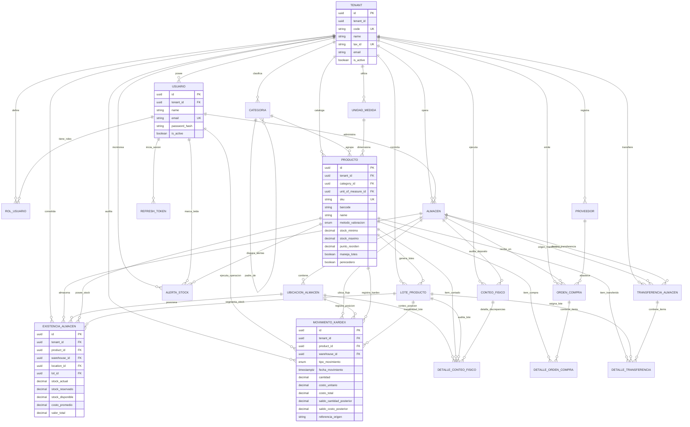

# SGCI - Modelo de Datos Multi-Tenant de Alto Rendimiento

**Sistema de Gestión de Control de Inventarios (SGCI)**  
**Motor de Base de Datos:** PostgreSQL 16+  
**Especificación Declarativa:** Prisma Schema v5+ ([`schema.prisma`](file:///C:/dev/SGCI/database/prisma/schema.prisma))  
**Compatibilidad ORM:** Eloquent ORM (Laravel 11) & Prisma Client (Node.js/TypeScript)  
**Patrón de Arquitectura:** Multi-Tenancy Lógico Estricto (Shared Database, Shared Schema con Row-Level Discrimination)

---

## 1. Filosofía de Diseño y Arquitectura Multi-Tenant

El modelo de datos de SGCI implementa un esquema **Multi-Tenant Estricto por Discriminador de Fila (`tenant_id`)**, optimizado para operaciones logísticas de alta concurrencia, trazabilidad inmutable y auditoría regulatoria de grado empresarial.

### 1.1. Regla Global de Estructura de Tablas
Para garantizar consistencia absoluta, trazabilidad y portabilidad entre el motor PostgreSQL, Prisma y Laravel Eloquent, **todas las 20 entidades de negocio** implementan obligatoriamente las siguientes 7 columnas canónicas:

| Columna | Tipo de Dato | Modificadores | Propósito Arquitectural |
| :--- | :--- | :--- | :--- |
| `id` | `UUID` | `@id @default(uuid())` | Llave primaria subrogada única global, inmune a ataques de enumeración y particionable. |
| `tenant_id` | `UUID` | `NOT NULL`, FK a `tenants.id` | Llave foránea de pertenencia organizacional. Primer campo obligatorio en todos los índices compuestos. |
| `created_at` | `TIMESTAMPTZ(6)` | `@default(now())` | Marca temporal inmutable de inserción en UTC con precisión de microsegundos. |
| `updated_at` | `TIMESTAMPTZ(6)` | `@updatedAt` | Marca temporal automática de última modificación en UTC. |
| `deleted_at` | `TIMESTAMPTZ(6)` | `NULLABLE` | Soporte nativo para Soft Delete (Borrado Lógico), compatible con el trait `SoftDeletes` de Eloquent. |
| `created_by` | `UUID` | `NULLABLE` | Auditoría del usuario autor del registro (`users.id`). |
| `updated_by` | `UUID` | `NULLABLE` | Auditoría del último usuario que modificó el registro (`users.id`). |

### 1.2. Aislamiento Lógico y Blindaje de Consultas
- A nivel de aplicación (Laravel 11), un **Global Scope** (`TenantScope`) inyecta automáticamente `WHERE tenant_id = current_tenant_id()` en cada consulta `SELECT`, `UPDATE` y `DELETE`.
- A nivel de base de datos PostgreSQL, los índices compuestos encabezados por `tenant_id` garantizan que el planificador de consultas ejecute escaneos indexados (`Index Scan` / `Bitmap Index Scan`) acotados exclusivamente a la partición lógica del cliente, evitando el escaneo de millones de registros de otras organizaciones.

---

## 2. Diagrama Entidad-Relación (Mermaid ERD)

A continuación se detalla la topología relacional de SGCI dividida en sus núcleos funcionales: Gobernanza Multi-Tenant, Catálogos Maestros, Infraestructura Física, Existencias, Movimientos Kardex y Abastecimiento/Auditoría.



---

## 3. Enums de Dominio y Vocabulario Técnico

El esquema incorpora 7 tipos enumerados nativos en PostgreSQL, reflejando el estándar internacional de logística, contabilidad de costos e inventarios:

### 3.1. `MetodoValoracion`
- `PEPS` (FIFO - First In, First Out): Valora salidas al costo de las existencias más antiguas.
- `UEPS` (LIFO - Last In, First Out): Valora salidas al costo de las existencias más recientes.
- `PROMEDIO_PONDERADO` (WAC - Weighted Average Cost): Recalcula el costo unitario medio móvil en cada compra o entrada de almacén según:
  $$\text{Costo Promedio} = \frac{\text{Valor Previo} + (\text{Cantidad Entrada} \times \text{Costo Entrada})}{\text{Cantidad Previa} + \text{Cantidad Entrada}}$$

### 3.2. `RolSistema` (Control de Acceso Basado en Roles - RBAC)
Matriz de privilegios de granularidad fina para SGCI:
1. `SUPER_ADMIN_SAAS`: Control de la infraestructura multi-empresa, altas de tenants y licencias.
2. `ADMIN_TENANT`: Administrador general de la compañía cliente, políticas y usuarios.
3. `GERENTE_OPERACIONES`: Supervisión ejecutiva, autorizaciones y tableros KPI.
4. `JEFE_ALMACEN`: Responsable directo de almacenes físicos, zonas y custodias.
5. `SUPERVISOR_INVENTARIO`: Monitoreo continuo de stocks, revisión de mermas y aprobaciones.
6. `ALMACENISTA_OPERADOR`: Operaciones de piso (recepción, despacho, reubicación y conteos).
7. `COMPRADOR_ABASTECIMIENTO`: Gestión de órdenes de compra y evaluación de proveedores.
8. `AUDITOR_INVENTARIO`: Auditorías periódicas, conteos ciegos y peritajes de discrepancias.
9. `CONTADOR_COSTOS`: Cierre mensual de inventarios, valorización Kardex y asientos contables.
10. `VISOR_CONSULTA`: Perfil de solo lectura para soporte, servicio al cliente o directivos.

### 3.3. `TipoMovimientoKardex`
Define la naturaleza operacional del asiento en el libro mayor inmutable:
- `ENTRADA_COMPRA`: Aumento por recepción física de orden de compra autorizada.
- `SALIDA_DESPACHO`: Disminución por venta o entrega final a cliente.
- `ENTRADA_TRANSFERENCIA`: Aumento en almacén receptor por traslado inter-almacén.
- `SALIDA_TRANSFERENCIA`: Disminución en almacén emisor por traslado inter-almacén.
- `AJUSTE_POSITIVO`: Aumento formal producto de conciliación física o recuperación de inventario.
- `AJUSTE_NEGATIVO`: Disminución formal producto de faltantes justificados en auditoría.
- `MERMA_DANO`: Pérdida reconocida por deterioro, rotura accidental o merma operativa.
- `DEVOLUCION_CLIENTE`: Reintegro de existencias devueltas por cliente tras inspección de calidad.
- `DEVOLUCION_PROVEEDOR`: Salida de existencias devueltas al proveedor por defectos de fábrica.

### 3.4. Enums de Flujo y Ciclo de Vida
- **`EstadoOrdenCompra`**: `BORRADOR` $\rightarrow$ `APROBADA` $\rightarrow$ `ENVIADA` $\rightarrow$ `RECIBIDA_PARCIAL` $\rightarrow$ `RECIBIDA_COMPLETA` (o `CANCELADA`).
- **`EstadoTransferencia`**: `SOLICITADA` $\rightarrow$ `EN_TRANSITO` $\rightarrow$ `RECIBIDA` (o `RECHAZADA`).
- **`EstadoConteoFisico`**: `PROGRAMADO` $\rightarrow$ `EN_PROGRESO` $\rightarrow$ `EN_CONCILIACION` $\rightarrow$ `APLICADO` (o `ANULADO`).
- **`TipoAlertaStock`**: `STOCK_MINIMO`, `STOCK_CRITICO`, `SOBRESTOCK`, `LOTE_POR_VENCER`, `LOTE_VENCIDO`, `DISCREPANCIA_CONTEO`.

---

## 4. Estrategia de Indexación Compuesta para Alto Rendimiento

En instalaciones empresariales con millones de transacciones de almacén, el diseño de índices determina si una consulta responde en $2\text{ ms}$ o colapsa el servidor por $30\text{ segundos}$.

### 4.1. Libro Mayor Kardex (`kardex_movements`)
El Kardex es un registro continuo de alta inserción. Las consultas más críticas corresponden a:
1. Reconstrucción del saldo histórico de un producto en un almacén para un rango de fechas.
2. Trazabilidad por documento fuente (`referencia_origen` como `"OC-2026-0001"`).

```prisma
// Índice compuesto de máxima selectividad:
@@index([tenant_id, product_id, warehouse_id, fecha_movimiento])

// Índices para reportes cronológicos y auditoría forense:
@@index([tenant_id, fecha_movimiento])
@@index([tenant_id, tipo_movimiento])
@@index([tenant_id, referencia_origen])
@@index([tenant_id, documento_origen_id])
```

**Análisis de Ejecución PostgreSQL (EXPLAIN ANALYZE):**
El planificador utiliza un `Index Scan using kardex_movements_tenant_id_product_id_warehouse_id_fecha_movimiento_idx`, filtrando directamente por los 3 primeros predicados y realizando un escaneo por rango de tipo `B-Tree` sobre `fecha_movimiento`, logrando costos de CPU mínimos y evitando escaneos secuenciales (`Seq Scan`).

### 4.2. Existencias en Tiempo Real (`warehouse_stocks`)
Consultas de disponibilidad inmediata durante procesos de facturación o despacho:
```prisma
@@index([tenant_id, product_id, warehouse_id])
@@index([tenant_id, warehouse_id, location_id])
@@index([tenant_id, lot_id])
```

### 4.3. Monitor de Vencimientos y Métodos FEFO (`product_lots`)
Para productos farmacéuticos o alimenticios con caducidad:
```prisma
@@unique([tenant_id, product_id, numero_lote])
@@index([tenant_id, product_id, fecha_vencimiento])
@@index([tenant_id, fecha_vencimiento])
```
Esto permite ejecutar el algoritmo **FEFO (First Expired, First Out)** ordenando por `fecha_vencimiento ASC` sin requerir costosos sorts en memoria (`Sort Method: external merge`).

---

## 5. Integridad Referencial y Reglas de Negocio

1. **Borrado en Cascada vs. Restricción Estricta**:
   - `Tenant` elimina en cascada (`onDelete: Cascade`) a sus entidades dependientes ante baja contractual del cliente.
   - `Producto` y `Almacen` poseen borrado restringido (`onDelete: Restrict`) en el `MovimientoKardex` y órdenes de compra. Es estrictamente imposible eliminar un producto o almacén si registra transacciones contables o de inventario.
2. **Inmutabilidad del Kardex (Append-Only Ledger)**:
   - Los registros de `kardex_movements` no se actualizan (`UPDATE`) ni se eliminan (`DELETE`) bajo ninguna circunstancia.
   - Cualquier error operativo en un despacho o recepción se subsana mediante un contra-movimiento de ajuste (`AJUSTE_POSITIVO` o `AJUSTE_NEGATIVO`), asegurando pista de auditoría forense inalterable.
3. **Auditoría Forense Integrada**:
   - Los campos `created_by` y `updated_by` vinculan directamente la identidad UUID del operador responsable, satisfaciendo normativas de control interno (COSO, ISO 27001).

---

## 6. Manejo de Concurrencia Crítica: Bloqueo Pesimista (`SELECT ... FOR UPDATE`)

### 6.1. La Condición de Carrera en Almacenes Concurrentes
En entornos con múltiples terminales (móviles de picking, despachos automáticos y facturación en simultáneo), dos procesos pueden intentar reservar o despachar el mismo stock disponible al mismo milisegundo:

```
Terminal A: Lee stock disponible = 5
Terminal B: Lee stock disponible = 5
Terminal A: Despacha 4 -> Actualiza stock disponible a 1
Terminal B: Despacha 3 -> Actualiza stock disponible a 2  <-- ¡CORRUPCIÓN! (El stock real debió ser -2)
```

### 6.2. Protocolo de Bloqueo Pesimista en PostgreSQL
Para impedir condiciones de carrera y sobre-despachos, SGCI exige el patrón de **bloqueo a nivel de fila (`FOR UPDATE`)** dentro de una transacción ACID explícita:

```sql
BEGIN;

-- 1. Bloqueo exclusivo de la fila de existencia para el tenant y almacén específico
SELECT id, stock_actual, stock_reservado, stock_disponible, costo_promedio
FROM warehouse_stocks
WHERE tenant_id = 'c56a4180-65aa-42ec-a945-5fd21dec0538'
  AND product_id = '7b29a279-7157-4f65-8b2b-ffbcad0e0001'
  AND warehouse_id = '8f3e2b10-4491-4e78-95b7-7819f72b0002'
FOR UPDATE;

-- 2. Validación de disponibilidad en memoria protegida por el lock
-- IF stock_disponible < :cantidad_a_despachar THEN ROLLBACK; ERROR('Stock insuficiente');

-- 3. Actualización atómica de existencias
UPDATE warehouse_stocks
SET stock_actual = stock_actual - 3.0000,
    stock_disponible = stock_disponible - 3.0000,
    valor_total = (stock_actual - 3.0000) * costo_promedio,
    updated_at = NOW(),
    updated_by = 'a12bc345-6789-4def-0123-abcdef012345'
WHERE id = '9912bb33-1122-4433-8899-aabbccddeeff';

-- 4. Inserción inmutable del movimiento en el Libro Kardex
INSERT INTO kardex_movements (
    id, tenant_id, product_id, warehouse_id, tipo_movimiento,
    fecha_movimiento, cantidad, costo_unitario, costo_total,
    saldo_cantidad_posterior, saldo_costo_posterior, saldo_valor_total_posterior,
    referencia_origen, tipo_documento_origen, created_at, updated_at, created_by
) VALUES (
    gen_random_uuid(), 'c56a4180-65aa-42ec-a945-5fd21dec0538',
    '7b29a279-7157-4f65-8b2b-ffbcad0e0001', '8f3e2b10-4491-4e78-95b7-7819f72b0002',
    'SALIDA_DESPACHO', NOW(), -3.0000, 15.5000, -46.5000,
    2.0000, 15.5000, 31.0000,
    'DESP-2026-0089', 'SALIDA_VENTA', NOW(), NOW(), 'a12bc345-6789-4def-0123-abcdef012345'
);

COMMIT;
```

### 6.3. Implementación Equivalente en Laravel 11 (Eloquent ORM)
En el backend de Laravel 11, este patrón se implementa de forma transparente con el helper `DB::transaction()` y el método `lockForUpdate()`:

```php
use Illuminate\Support\Facades\DB;
use App\Models\ExistenciaAlmacen;
use App\Models\MovimientoKardex;
use App\Enums\TipoMovimientoKardex;

DB::transaction(function () use ($tenantId, $productId, $warehouseId, $cantidadADespachar, $userId) {
    // Bloqueo pesimista de fila en PostgreSQL
    $stock = ExistenciaAlmacen::where('tenant_id', $tenantId)
        ->where('product_id', $productId)
        ->where('warehouse_id', $warehouseId)
        ->lockForUpdate()
        ->firstOrFail();

    if ($stock->stock_disponible < $cantidadADespachar) {
        throw new \DomainException("Existencias insuficientes para realizar el despacho.");
    }

    // Actualización atómica de existencias
    $stock->stock_actual -= $cantidadADespachar;
    $stock->stock_disponible -= $cantidadADespachar;
    $stock->valor_total = $stock->stock_actual * $stock->costo_promedio;
    $stock->updated_by = $userId;
    $stock->save();

    // Registro inmutable de Kardex
    MovimientoKardex::create([
        'tenant_id' => $tenantId,
        'product_id' => $productId,
        'warehouse_id' => $warehouseId,
        'tipo_movimiento' => TipoMovimientoKardex::SALIDA_DESPACHO,
        'fecha_movimiento' => now(),
        'cantidad' => -$cantidadADespachar,
        'costo_unitario' => $stock->costo_promedio,
        'costo_total' => -($cantidadADespachar * $stock->costo_promedio),
        'saldo_cantidad_posterior' => $stock->stock_actual,
        'saldo_costo_posterior' => $stock->costo_promedio,
        'saldo_valor_total_posterior' => $stock->valor_total,
        'referencia_origen' => 'DESP-2026-0089',
        'tipo_documento_origen' => 'SALIDA_VENTA',
        'created_by' => $userId,
        'updated_by' => $userId,
    ]);
});
```

---

## 7. Verificación de Compatibilidad y Sincronización

- **Archivo de Definición Prisma:** [`schema.prisma`](file:///C:/dev/SGCI/database/prisma/schema.prisma)
- **Generación de Migraciones PostgreSQL (Laravel/Prisma):**
  - Para generar el cliente TypeScript: `npx prisma generate`
  - Para desplegar migraciones a base de datos: `npx prisma migrate dev --name init_sgci_schema`
  - En Laravel 11, las tablas corresponden al plural en snake_case definido mediante la directiva `@@map(...)` (`tenants`, `users`, `products`, `warehouse_stocks`, `kardex_movements`, etc.).
