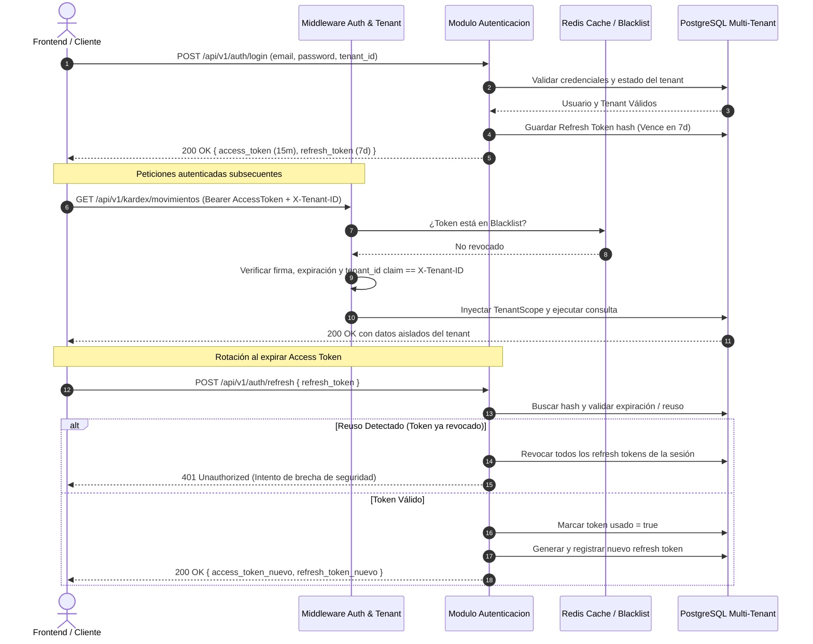

# SGCI - Especificación Técnica de API Backend y WebSockets
**Sistema de Gestión de Control de Inventarios (Multi-Tenant)**
Versión API: `v1` | Arquitectura: **Screaming Architecture** | Lenguaje: **PHP 8.2+ / Laravel 11**

---

## 1. Arquitectura General y Convenciones

La API REST del SGCI se rige bajo los siguientes principios:
- **Base URL**: `/api/v1`
- **Formato de Intercambio**: `application/json` (UTF-8)
- **Fechas y Horas**: Formato ISO 8601 UTC (`YYYY-MM-DDTHH:mm:ssZ`)
- **Identificadores**: UUIDv4 para todas las entidades (`id`, `tenant_id`, etc.)
- **Multi-Tenancy Estricto**: Aislamiento por `tenant_id`. La identificación del tenant se extrae del claim `tenant_id` en el JWT y se valida bidireccionalmente contra el encabezado `X-Tenant-ID`.
- **Idempotencia**: Clave opcional `Idempotency-Key` (UUIDv4) en endpoints de mutación crítica (`POST /kardex/movimientos`).

### Códigos de Estado HTTP Estándar

| Código | Significado | Descripción |
|---|---|---|
| `200 OK` | Éxito | Solicitud procesada correctamente con retorno de datos. |
| `201 Created` | Creado | Recurso creado exitosamente (retorna cabecera `Location` o payload). |
| `204 No Content` | Sin Contenido | Acción exitosa sin cuerpo de retorno (ej. eliminaciones). |
| `400 Bad Request` | Petición Inválida | Reglas de negocio incumplidas (ej. stock insuficiente). |
| `401 Unauthorized` | No Autenticado | Token JWT ausente, expirado, inválido o revocado. |
| `403 Forbidden` | Prohibido | Rol insuficiente en RBAC o violación de aislamiento de tenant. |
| `404 Not Found` | No Encontrado | Recurso inexistente dentro del tenant actual. |
| `409 Conflict` | Conflicto | Conflicto de concurrencia o duplicidad de clave única. |
| `422 Unprocessable` | Error Validación | Fallo en validación semántica de campos en el payload. |
| `500 Server Error` | Error Interno | Excepción no controlada del backend. |

### Estructura Estándar de Respuesta

#### Respuesta Exitosa
```json
{
  "exito": true,
  "mensaje": "Operación ejecutada exitosamente.",
  "datos": {},
  "meta": {
    "timestamp": "2026-10-29T10:00:00Z",
    "version": "v1",
    "tenant_id": "a1b2c3d4-e5f6-7a8b-9c0d-1e2f3a4b5c6d"
  }
}
```

#### Respuesta de Error
```json
{
  "exito": false,
  "codigo_error": "STOCK_INSUFICIENTE",
  "mensaje": "No hay stock disponible suficiente en el almacén para completar la salida solicitada.",
  "detalles": {
    "producto_id": "8f5e13d0-3cb8-4e1d-84ad-62d22b27a3e1",
    "almacen_id": "550e8400-e29b-41d4-a716-446655440000",
    "cantidad_solicitada": 50.0,
    "cantidad_disponible": 18.5
  },
  "timestamp": "2026-10-29T10:00:00Z"
}
```

---

## 2. Autenticación JWT y Refresh Tokens

### Flujo Criptográfico de Tokens
1. **Access Token**: JWT firmado con algoritmo `RS256` o `HS256`, vigencia corta (**15 minutos**). Contiene:
   - `sub`: UUID del usuario.
   - `tenant_id`: UUID de la empresa/organización tenant.
   - `rol`: Slug del rol RBAC asignado.
   - `permisos`: Array de permisos granulares.
2. **Refresh Token**: Token opaco de alta entropía (64 bytes hex), persistido en base de datos con hash SHA-256, vigencia de **7 días**.
3. **Rotación Estricta**: Cada invocación a `/api/v1/auth/refresh` revoca el token anterior e invalida cualquier intento de reuso (detección de robo de token con invalidación en cascada).
4. **Revocación Inmediata**: Lista negra administrada en memoria Redis para tokens activos revocados antes de su expiración.



---

## 3. Middlewares de Seguridad y Contexto

### 3.1 Middleware: `VerificarContextoTenant`
- **Propósito**: Garantizar que cada petición opere estrictamente en el entorno de datos de su tenant correspondiente.
- **Acciones**:
  1. Extrae el `tenant_id` del token JWT verificado.
  2. Comprueba la presencia del encabezado `X-Tenant-ID`.
  3. Valida la coincidencia exacta: si `JWT.tenant_id !== Header.X-Tenant-ID`, aborta con `403 Forbidden` (`DISCREPANCIA_CONTEXTO_TENANT`).
  4. Consulta el estado del tenant en caché/DB: si el tenant está en estado `SUSPENDIDO` o `INACTIVO`, aborta con `403 Forbidden` (`TENANT_BLOQUEADO`).
  5. Asigna el tenant verificado a la clase singleton `ContextoTenant` en el contenedor de servicios de Laravel para alimentar el `TenantScope` de Eloquent.

### 3.2 Middleware: `AutorizarRolRbac`
- **Propósito**: Control de acceso basado en roles con jerarquías y políticas de autorización por módulo.
- **Matriz de los 10 Roles del Sistema**:

| # | Slug del Rol | Nombre del Rol | Alcance y Permisos Principales |
|---|---|---|---|
| 1 | `SUPER_ADMIN_SAAS` | Super Administrador SaaS | Administrador supremo de la plataforma SaaS multi-empresa, gestión global de inquilinos y telemetría de infraestructura. |
| 2 | `ADMIN_TENANT` | Administrador de Tenant | Administrador general de la empresa/organización, sucursales, configuración contable y usuarios. |
| 3 | `GERENTE_OPERACIONES` | Gerente de Operaciones | Gerencia operativa, reportes estratégicos, aprobación de transferencias mayores y ajustes de inventario. |
| 4 | `JEFE_ALMACEN` | Jefe de Almacén | Control técnico total de depósitos, zonas, racks, transferencias, mermas y despachos. |
| 5 | `SUPERVISOR_INVENTARIO` | Supervisor de Inventario | Supervisión y calendarización de conteos, aprobación de variaciones, cuarentena y alertas FEFO/PEPS. |
| 6 | `ALMACENISTA_OPERADOR` | Almacenista / Operador (PWA) | Picking, packing, recepciones físicas y despachos en pasillo mediante escáner PWA. |
| 7 | `COMPRADOR_ABASTECIMIENTO` | Comprador / Abastecimiento | Gestión de proveedores, emisión y seguimiento de órdenes de compra (OC) y control de reorden. |
| 8 | `AUDITOR_INVENTARIO` | Auditor de Inventarios | Conteos ciegos en campo sin visibilidad de stock teórico, actas de discrepancia e informes forenses. |
| 9 | `CONTADOR_COSTOS` | Contador de Costos | Valorización de inventarios, libro mayor Kardex permanente (PEPS/UEPS/CPP) y cierres contables/fiscales. |
| 10| `VISOR_CONSULTA` | Visor de Consulta | Lectura pasiva de catálogos, existencias consolidadas y tableros sin facultades de mutación. |

---

## 4. Canales de WebSockets en Tiempo Real

El sistema utiliza **Laravel Reverb** con compatibilidad de protocolo Pusher para suscripciones seguras y reactivas.

### 4.1 Endpoint de Autenticación de Canales
- **Ruta**: `POST /api/v1/broadcasting/auth`
- **Headers**:
  - `Authorization: Bearer <access_token>`
  - `X-Tenant-ID: <uuid>`
- **Payload**:
  ```json
  {
    "socket_id": "1234.5678",
    "channel_name": "private-tenant.b2a755d7-1294-4d8e-94e8-283186d6d45e.almacen.8c0dbbf7-93ae-432d-9657-3f3ca7e8c076"
  }
  ```

### 4.2 Especificación de Canales Privados

#### Canal 1: `private-tenant.{tenantId}.almacen.{almacenId}`
Destinado al personal operativo y dashboards específicos de una sucursal o almacén físico.

- **Evento: `stock.actualizado`**
  ```json
  {
    "evento": "stock.actualizado",
    "tenant_id": "b2a755d7-1294-4d8e-94e8-283186d6d45e",
    "almacen_id": "8c0dbbf7-93ae-432d-9657-3f3ca7e8c076",
    "producto_id": "e674c935-7d88-46c5-8f6a-4978be4faee5",
    "lote_id": "76fa968b-5926-4ee8-a5c9-cfa261f91c98",
    "cantidad_anterior": 150.0,
    "nueva_cantidad": 130.0,
    "tipo_movimiento": "SALIDA_DESPACHO",
    "actualizado_en": "2026-10-29T10:15:30Z"
  }
  ```

- **Evento: `movimiento.kardex.registrado`**
  ```json
  {
    "evento": "movimiento.kardex.registrado",
    "movimiento_id": "a90b84f2-984e-4f19-b50a-8bf8c8e19c32",
    "producto_codigo": "PROD-ALM-001",
    "cantidad": 20.0,
    "costo_unitario": 12.50,
    "saldo_cantidad": 130.0,
    "saldo_costo_total": 1625.00,
    "operador": "Juan Pérez"
  }
  ```

#### Canal 2: `private-tenant.{tenantId}.alertas`
Canal global del tenant para supervisiones gerenciales, control de mermas y auditoría continua.

- **Evento: `stock.critico.detectado`**
  ```json
  {
    "evento": "stock.critico.detectado",
    "alerta_id": "f47ac10b-58cc-4372-a567-0e02b2c3d479",
    "tenant_id": "b2a755d7-1294-4d8e-94e8-283186d6d45e",
    "almacen_id": "8c0dbbf7-93ae-432d-9657-3f3ca7e8c076",
    "almacen_nombre": "Almacén Central Madrid",
    "producto_id": "e674c935-7d88-46c5-8f6a-4978be4faee5",
    "producto_nombre": "Válvula Hidráulica Industrial 2 Pulgadas",
    "producto_sku": "SKU-VALV-2P",
    "stock_actual": 8.0,
    "stock_minimo": 15.0,
    "punto_reorden": 25.0,
    "nivel_severidad": "CRITICO",
    "creado_en": "2026-10-29T10:16:00Z"
  }
  ```

- **Evento: `lote.por.vencer`**
  ```json
  {
    "evento": "lote.por.vencer",
    "tenant_id": "b2a755d7-1294-4d8e-94e8-283186d6d45e",
    "lote_id": "76fa968b-5926-4ee8-a5c9-cfa261f91c98",
    "codigo_lote": "LOT-2026-OCT-88",
    "fecha_vencimiento": "2026-11-05",
    "dias_restantes": 7,
    "cantidad_remanente": 450.0,
    "almacen_id": "8c0dbbf7-93ae-432d-9657-3f3ca7e8c076"
  }
  ```

- **Evento: `conteo.discrepancia.detectada`**
  ```json
  {
    "evento": "conteo.discrepancia.detectada",
    "auditoria_id": "18cf6721-3964-42b7-a3a8-4e311516f8ec",
    "producto_id": "e674c935-7d88-46c5-8f6a-4978be4faee5",
    "stock_teorico": 130.0,
    "stock_fisico_contado": 124.0,
    "diferencia": -6.0,
    "porcentaje_desviacion": -4.61,
    "auditor_responsable": "Carlos Mendoza"
  }
  ```

---

## 5. Endpoints por Módulo de Negocio (Screaming Architecture)

```
app/Modulos/
├── Autenticacion/
├── Catalogo/
├── Almacenes/
├── Kardex/
├── LotesVencimientos/
├── Compras/
├── AuditoriaConteos/
└── AlertasTiempoReal/
```

---

### 5.1 Módulo: `Autenticacion`

#### `POST /api/v1/auth/login`
- **Descripción**: Autentica credenciales y emite par de tokens JWT.
- **Acceso**: Público (Validado por Tenant).
- **Request Body**:
```json
{
  "email": "gerente@empresa.com",
  "password": "Password123*!",
  "tenant_id": "b2a755d7-1294-4d8e-94e8-283186d6d45e"
}
```
- **Response 200 OK**:
```json
{
  "exito": true,
  "datos": {
    "usuario": {
      "id": "e9b5a821-2e11-471a-9f4c-1d0937a1d132",
      "nombre": "Ana Morales",
      "email": "gerente@empresa.com",
      "rol": "GERENTE_OPERACIONES"
    },
    "tokens": {
      "tipo": "Bearer",
      "access_token": "eyJhbGciOiJIUzI1NiIsInR5cCI6IkpXVCJ9...",
      "expires_in_seconds": 900,
      "refresh_token": "4f8a09cf9321e14930be62817290..."
    }
  }
}
```

#### `POST /api/v1/auth/refresh`
- **Descripción**: Rota el access token y emite un nuevo refresh token revocando el anterior.
- **Request Body**:
```json
{
  "refresh_token": "4f8a09cf9321e14930be62817290..."
}
```
- **Response 200 OK**:
```json
{
  "exito": true,
  "datos": {
    "access_token": "eyJhbGciOiJIUzI1NiIsInR5cCI6IkpXVCJ9...",
    "expires_in_seconds": 900,
    "refresh_token": "921df01cb58e41a2719a0029b47e..."
  }
}
```

#### `POST /api/v1/auth/logout`
- **Descripción**: Revoca de inmediato el access token actual en Redis y marca el refresh token como revocado.
- **Headers**: `Authorization: Bearer <token>`, `X-Tenant-ID: <uuid>`
- **Response 200 OK**:
```json
{
  "exito": true,
  "mensaje": "Sesión cerrada correctamente."
}
```

---

### 5.2 Módulo: `Catalogo`

#### `GET /api/v1/catalogo/productos`
- **Descripción**: Listado paginado y filtrable de productos del tenant.
- **Roles Permitidos**: Todos los 10 roles.
- **Query Params**: `page=1`, `per_page=15`, `categoria_id`, `buscar`, `estado=ACTIVO`.
- **Response 200 OK**:
```json
{
  "exito": true,
  "datos": [
    {
      "id": "e674c935-7d88-46c5-8f6a-4978be4faee5",
      "sku": "SKU-VALV-2P",
      "codigo_barras": "7501234567890",
      "nombre": "Válvula Hidráulica Industrial 2 Pulgadas",
      "categoria": {
        "id": "18cf6721-3964-42b7-a3a8-4e311516f8ec",
        "nombre": "Fontanería Industrial"
      },
      "unidad_medida": "UNIDAD",
      "metodo_valoracion": "PROMEDIO_PONDERADO",
      "stock_minimo": 15.0,
      "punto_reorden": 25.0,
      "stock_maximo": 200.0,
      "controla_lotes": true,
      "estado": "ACTIVO"
    }
  ],
  "meta": {
    "total": 142,
    "current_page": 1,
    "last_page": 10
  }
}
```

#### `POST /api/v1/catalogo/productos`
- **Descripción**: Registra un nuevo producto en el catálogo.
- **Roles Permitidos**: `SUPER_ADMIN_SAAS`, `ADMIN_TENANT`, `GERENTE_OPERACIONES`.
- **Request Body**:
```json
{
  "sku": "SKU-BOMBA-05HP",
  "codigo_barras": "7509988776655",
  "nombre": "Bomba Centrífuga 0.5 HP",
  "descripcion": "Bomba para líquidos industriales de baja viscosidad",
  "categoria_id": "18cf6721-3964-42b7-a3a8-4e311516f8ec",
  "unidad_medida": "UNIDAD",
  "metodo_valoracion": "PEPS",
  "stock_minimo": 10.0,
  "punto_reorden": 20.0,
  "stock_maximo": 100.0,
  "controla_lotes": true
}
```
- **Response 201 Created**: Devuelve el recurso recién creado.

---

### 5.3 Módulo: `Almacenes`

#### `GET /api/v1/almacenes`
- **Descripción**: Lista de almacenes físicos y virtuales asignados al tenant.
- **Roles Permitidos**: Todos.

#### `GET /api/v1/almacenes/{id}/existencias`
- **Descripción**: Existencias agregadas y desglosadas por lote en un almacén.
- **Roles Permitidos**: Todos excepto `SUPER_ADMIN_SAAS` (si consulta contexto tenant específico).
- **Response 200 OK**:
```json
{
  "exito": true,
  "datos": {
    "almacen_id": "8c0dbbf7-93ae-432d-9657-3f3ca7e8c076",
    "almacen_nombre": "Almacén Central",
    "productos": [
      {
        "producto_id": "e674c935-7d88-46c5-8f6a-4978be4faee5",
        "sku": "SKU-VALV-2P",
        "cantidad_total": 130.0,
        "cantidad_reservada": 10.0,
        "cantidad_disponible": 120.0,
        "costo_promedio": 12.50,
        "valor_total_existencia": 1625.00,
        "lotes": [
          {
            "lote_id": "76fa968b-5926-4ee8-a5c9-cfa261f91c98",
            "codigo_lote": "LOT-2026-OCT-88",
            "fecha_vencimiento": "2026-11-05",
            "cantidad": 50.0,
            "estado": "LIBERADO"
          },
          {
            "lote_id": "89ab12cd-ef34-4567-8901-abcdef123456",
            "codigo_lote": "LOT-2026-NOV-01",
            "fecha_vencimiento": "2027-04-30",
            "cantidad": 80.0,
            "estado": "LIBERADO"
          }
        ]
      }
    ]
  }
}
```

#### `POST /api/v1/almacenes/transferencias`
- **Descripción**: Solicita o despacha una transferencia de existencias entre dos almacenes del mismo tenant.
- **Roles Permitidos**: `SUPER_ADMIN_SAAS`, `ADMIN_TENANT`, `GERENTE_OPERACIONES`, `JEFE_ALMACEN`.
- **Request Body**:
```json
{
  "almacen_origen_id": "8c0dbbf7-93ae-432d-9657-3f3ca7e8c076",
  "almacen_destino_id": "332e1400-e29b-41d4-a716-446655449999",
  "motivo": "Reabastecimiento de Sucursal Norte",
  "items": [
    {
      "producto_id": "e674c935-7d88-46c5-8f6a-4978be4faee5",
      "lote_id": "76fa968b-5926-4ee8-a5c9-cfa261f91c98",
      "cantidad": 15.0
    }
  ]
}
```
- **Response 201 Created**: Retorna el registro de transferencia con estado `EN_TRANSITO`.

---

### 5.4 Módulo: `Kardex`

#### `POST /api/v1/kardex/movimientos`
- **Descripción**: Registro atómico de movimientos físicos y contables (Entradas, Salidas, Ajustes). Ejecuta la estrategia de valoración (`CPP` o `PEPS`) y dispara observadores de existencias y WebSockets.
- **Roles Permitidos**: `SUPER_ADMIN_SAAS`, `ADMIN_TENANT`, `GERENTE_OPERACIONES`, `JEFE_ALMACEN`, `ALMACENISTA_OPERADOR`.
- **Headers**: `Idempotency-Key: <uuid>` (recomendado).
- **Request Body**:
```json
{
  "almacen_id": "8c0dbbf7-93ae-432d-9657-3f3ca7e8c076",
  "producto_id": "e674c935-7d88-46c5-8f6a-4978be4faee5",
  "lote_id": "76fa968b-5926-4ee8-a5c9-cfa261f91c98",
  "tipo_movimiento": "SALIDA_DESPACHO",
  "cantidad": 20.0,
  "costo_unitario": 0.0,
  "referencia_documento": "GUIA-DESPACHO-2026-0045",
  "observacion": "Despacho a cliente Orden #9921"
}
```
- **Response 201 Created**:
```json
{
  "exito": true,
  "datos": {
    "id": "a90b84f2-984e-4f19-b50a-8bf8c8e19c32",
    "tenant_id": "b2a755d7-1294-4d8e-94e8-283186d6d45e",
    "almacen_id": "8c0dbbf7-93ae-432d-9657-3f3ca7e8c076",
    "producto_id": "e674c935-7d88-46c5-8f6a-4978be4faee5",
    "lote_id": "76fa968b-5926-4ee8-a5c9-cfa261f91c98",
    "tipo_movimiento": "SALIDA_DESPACHO",
    "cantidad": 20.0,
    "costo_unitario_aplicado": 12.50,
    "costo_total_movimiento": 250.00,
    "saldo_cantidad_resultante": 130.0,
    "saldo_costo_total_resultante": 1625.00,
    "metodo_valoracion": "PROMEDIO_PONDERADO",
    "creado_en": "2026-10-29T10:15:30Z"
  }
}
```
- **Response 400 Bad Request** (si no hay existencias y no se permite stock negativo):
```json
{
  "exito": false,
  "codigo_error": "STOCK_INSUFICIENTE",
  "mensaje": "Stock insuficiente para ejecutar el movimiento de salida.",
  "detalles": {
    "cantidad_disponible": 10.0,
    "cantidad_requerida": 20.0
  }
}
```

#### `GET /api/v1/kardex/movimientos`
- **Descripción**: Consulta cronológica del Kardex por producto, almacén o rango de fechas.
- **Roles Permitidos**: Todos los 10 roles.
- **Query Params**: `producto_id`, `almacen_id`, `fecha_inicio`, `fecha_fin`, `tipo_movimiento`.

#### `GET /api/v1/kardex/valoracion/{productoId}`
- **Descripción**: Obtiene la valoración contable y desglose de capas de inventario del producto.
- **Roles Permitidos**: `SUPER_ADMIN_SAAS`, `ADMIN_TENANT`, `GERENTE_OPERACIONES`, `JEFE_ALMACEN`, `CONTADOR_COSTOS`, `AUDITOR_INVENTARIO`, `VISOR_CONSULTA`.

---

### 5.5 Módulo: `LotesVencimientos`

#### `GET /api/v1/lotes/proximos-vencer`
- **Descripción**: Reporte y alerta de lotes que vencen dentro de la ventana configurada (ej. 30 días).
- **Roles Permitidos**: `SUPER_ADMIN_SAAS`, `ADMIN_TENANT`, `GERENTE_OPERACIONES`, `JEFE_ALMACEN`, `SUPERVISOR_INVENTARIO`, `AUDITOR_INVENTARIO`.
- **Query Params**: `dias_anticipacion=30`, `almacen_id`.

#### `PATCH /api/v1/lotes/{id}/estado`
- **Descripción**: Actualiza el estado de control de calidad del lote (`LIBERADO`, `CUARENTENA`, `RECHAZADO`, `VENCIDO`).
- **Roles Permitidos**: `SUPER_ADMIN_SAAS`, `ADMIN_TENANT`, `GERENTE_OPERACIONES`, `JEFE_ALMACEN`, `SUPERVISOR_INVENTARIO`.
- **Request Body**:
```json
{
  "estado": "CUARENTENA",
  "motivo": "Inspección por rotura de empaque en transporte primario",
  "bloquear_despachos": true
}
```
- **Response 200 OK**:
```json
{
  "exito": true,
  "mensaje": "Estado del lote actualizado exitosamente a CUARENTENA."
}
```

---

### 5.6 Módulo: `Compras`

#### `POST /api/v1/compras/ordenes`
- **Descripción**: Creación de orden de compra a proveedor.
- **Roles Permitidos**: `SUPER_ADMIN_SAAS`, `ADMIN_TENANT`, `GERENTE_OPERACIONES`, `COMPRADOR_ABASTECIMIENTO`.

#### `POST /api/v1/compras/ordenes/{id}/recepcion`
- **Descripción**: Recepción física de mercancía de compra. Genera movimientos de entrada en el Kardex y asignación de lotes con fechas de vencimiento.
- **Roles Permitidos**: `SUPER_ADMIN_SAAS`, `ADMIN_TENANT`, `GERENTE_OPERACIONES`, `JEFE_ALMACEN`, `ALMACENISTA_OPERADOR`, `COMPRADOR_ABASTECIMIENTO`.
- **Request Body**:
```json
{
  "almacen_id": "8c0dbbf7-93ae-432d-9657-3f3ca7e8c076",
  "numero_factura_proveedor": "FAC-PROV-99381",
  "items": [
    {
      "producto_id": "e674c935-7d88-46c5-8f6a-4978be4faee5",
      "cantidad_recibida": 50.0,
      "costo_unitario_compra": 11.80,
      "codigo_lote": "LOT-2026-OCT-99",
      "fecha_fabricacion": "2026-10-01",
      "fecha_vencimiento": "2028-10-01"
    }
  ]
}
```
- **Response 200 OK**: Retorna el comprobante de recepción y los movimientos Kardex generados.

---

### 5.7 Módulo: `AuditoriaConteos`

#### `POST /api/v1/auditoria/conteos`
- **Descripción**: Inicia una sesión de conteo físico o cíclico en un almacén.
- **Roles Permitidos**: `SUPER_ADMIN_SAAS`, `ADMIN_TENANT`, `GERENTE_OPERACIONES`, `SUPERVISOR_INVENTARIO`, `AUDITOR_INVENTARIO`.
- **Request Body**:
```json
{
  "almacen_id": "8c0dbbf7-93ae-432d-9657-3f3ca7e8c076",
  "tipo_conteo": "CICLICO_CATEGORIA",
  "categoria_id": "18cf6721-3964-42b7-a3a8-4e311516f8ec",
  "conteo_ciego": true,
  "notas": "Auditoría mensual de cierre de mes"
}
```
- **Response 201 Created**: Devuelve la sesión de auditoría con estado `EN_PROGRESO`.

#### `POST /api/v1/auditoria/conteos/{id}/registro-items`
- **Descripción**: Registro de conteos físicos efectuados por los auditores y operadores.
- **Roles Permitidos**: `SUPER_ADMIN_SAAS`, `JEFE_ALMACEN`, `SUPERVISOR_INVENTARIO`, `AUDITOR_INVENTARIO`, `ALMACENISTA_OPERADOR`.
- **Request Body**:
```json
{
  "conteos": [
    {
      "producto_id": "e674c935-7d88-46c5-8f6a-4978be4faee5",
      "lote_id": "76fa968b-5926-4ee8-a5c9-cfa261f91c98",
      "cantidad_contada": 48.0
    }
  ]
}
```

#### `POST /api/v1/auditoria/conteos/{id}/cerrar-conciliar`
- **Descripción**: Cierra la sesión de conteo. Si existen discrepancias, genera automáticamente los movimientos de ajuste en el Kardex y notifica vía WebSockets.
- **Roles Permitidos**: `SUPER_ADMIN_SAAS`, `ADMIN_TENANT`, `GERENTE_OPERACIONES`, `SUPERVISOR_INVENTARIO`.

---

### 5.8 Módulo: `AlertasTiempoReal`

#### `GET /api/v1/alertas`
- **Descripción**: Consulta las alertas activas del tenant (stock crítico, lotes por vencer, discrepancias).
- **Roles Permitidos**: Todos excepto `VISOR_CONSULTA`.

#### `PATCH /api/v1/alertas/{id}/leida`
- **Descripción**: Marca una alerta como leída / gestionada por un operador.
- **Roles Permitidos**: Todos los roles operativos y gerenciales.

#### `PUT /api/v1/alertas/configuracion`
- **Descripción**: Configura los parámetros globales de umbrales y canales de notificación por tenant.
- **Roles Permitidos**: `SUPER_ADMIN_SAAS`, `ADMIN_TENANT`, `GERENTE_OPERACIONES`.
- **Request Body**:
```json
{
  "dias_alerta_vencimiento": 30,
  "notificar_stock_minimo_inmediato": true,
  "porcentaje_tolerancia_discrepancia_conteo": 2.0
}
```
- **Response 200 OK**: Configuración actualizada.
