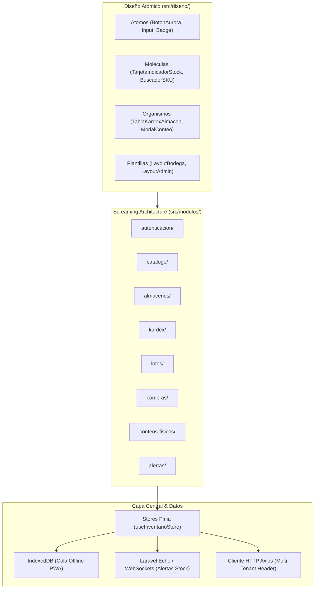
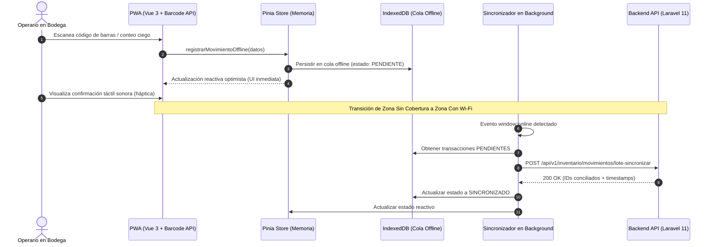

# Arquitectura Frontend & UX - SGCI (Sistema de Gestión de Control de Inventarios)

Este documento define la especificación técnica y de experiencia de usuario (UX) para el Frontend del **SGCI**. La arquitectura está concebida bajo principios de grado industrial para entornos de bodegas, centros de distribución y oficinas de auditoría, implementando **Vue.js 3 (`<script setup lang="ts">`)**, **TypeScript estricto**, **Pinia**, **Tailwind CSS**, **Screaming Architecture**, **Atomic Design**, la **Paleta Oficial Aurora Mist** y capacidades **PWA Mobile-First** con sincronización offline.

---

## 1. Principios Arquitectónicos Fundamentales



### 1.1. Screaming Architecture (`src/modulos/`)
La estructura de directorios "grita" el dominio del negocio de control de inventarios. Cada módulo es autónomo y encapsula sus propias vistas, componentes de dominio, stores de Pinia, servicios API, tipos y pruebas:

```text
src/modulos/
├── autenticacion/         # Inicio de sesión, recuperación, validación de tenant y MFA
├── catalogo/              # Gestión de productos, SKUs, categorías y unidades de medida
├── almacenes/             # Sedes, naves, pasillos, estanterías y ubicaciones físicas
├── kardex/                # Libro mayor de movimientos (entradas, salidas, saldos PEPS/CPP)
├── lotes/                 # Trazabilidad de lotes, números de serie y fechas de vencimiento
├── compras/               # Recepción de órdenes de compra, control contra facturas y remisiones
├── conteos-fisicos/       # Conteos ciegos periódicos, escaneo masivo y ajustes de inventario
└── alertas/               # Notificaciones de stock crítico, reorden y lotes por vencer
```

### 1.2. Atomic Design (`src/diseno/`)
Los componentes de interfaz agnósticos al dominio residen en `src/diseno/`:
- **Átomos (`src/diseno/atomos/`):** Elementos indivisibles con accesibilidad táctil Mobile-First (ej. `BotonAurora.vue`, `BadgeEstado.vue`, `InputCodigoBarras.vue`).
- **Moléculas (`src/diseno/moleculas/`):** Combinaciones de átomos con propósito unitario (ej. `TarjetaIndicadorStock.vue`, `SelectorUbicacionAlmacen.vue`, `CampoEscaneoSKU.vue`).
- **Organismos (`src/diseno/organismos/`):** Estructuras complejas reutilizables (ej. `TablaKardexAlmacen.vue`, `PanelResumenExistencias.vue`, `ModalAjusteInventario.vue`).
- **Plantillas (`src/diseno/plantillas/`):** Estructuras de página responsive con barra de estado de red (online/offline) y navegación de bodega.

---

## 2. Sistema de Color Oficial: Paleta Aurora Mist

La identidad visual del SGCI se rige por la paleta cromática **Aurora Mist**, diseñada específicamente para mitigar la fatiga visual en operarios de almacén bajo iluminación artificial y garantizar altos niveles de contraste WCAG 2.1 AA/AAA en pantallas móviles rugerizadas.

| Token Semántico | Código HEX | Rol en la Interfaz | Ejemplo de Uso |
| :--- | :---: | :--- | :--- |
| `aurora-profundo` | `#203959` | Navegación, encabezados y fondos profundos | Barra superior, sidebar de escritorio, tarjetas oscuras de KPIs |
| `aurora-primario` | `#416772` | Acciones principales, botones primarios y gráficas | Botón de confirmación de conteo, gráficos de rotación de inventario |
| `aurora-acento` | `#96ADA5` | Acentos, estados óptimos y elementos secundarios | Badges de estado "En Existencia", bordes activos, indicadores de éxito |
| `aurora-contraste` | `#ABB7B3` | Contraste claro, textos y superficies secundarias | Textos sobre fondos oscuros `#203959`, bordes divisorios suaves |
| `aurora-desactivado` | `#839492` | Textos secundarios, bordes neutros y estados disabled | Botones bloqueados, metadatos de auditoría, etiquetas secundarias |

### 2.1. Tokens en Tailwind CSS
```typescript
// extracto conceptual
colors: {
  aurora: {
    profundo: '#203959',
    primario: '#416772',
    acento: '#96ADA5',
    contraste: '#ABB7B3',
    desactivado: '#839492',
  }
}
```

---

## 3. Estrategia PWA Mobile-First para Bodegas

Los operarios de bodega se desplazan entre naves logísticas donde la cobertura Wi-Fi suele ser intermitente o nula (zonas frías, túneles de congelación o estanterías metálicas densas). Por ello, el sistema adopta un diseño **Offline-First**.



### 3.1. Escaneo de Códigos de Barras y QR
- Uso preferente de la **Shape Detection API (`BarcodeDetector`)** de navegadores modernos en Android/iOS para decodificación nativa por GPU de códigos EAN-13, Code 128, QR y DataMatrix.
- Fallback automático mediante librería WebAssembly/JavaScript sin congelar el hilo principal de la UI.
- Interfaz táctil ergonómica con **zona de impacto mínimo de 44x44 px** para operarios que utilizan guantes de protección.

### 3.2. Cola de Sincronización Offline (`IndexedDB` + Pinia)
1. Cada transacción realizada en modo desconectado recibe un identificador universal temporal (`uuid-v4`) con metadata de auditoría: `tenant_id`, `created_by`, `timestamp_local` y `version_vector`.
2. Las transacciones se encolan en la base de datos local `IndexedDB` a través de la librería liviana `idb`.
3. Al restaurarse la conectividad (`navigator.onLine` y evento `online`), el despachador de Pinia procesa secuencialmente la cola garantizando idempotencia en el servidor mediante el header `X-Idempotency-Key`.
4. Los conflictos de conteo ciego se dirigen a la bandeja de discrepancias para revisión del **Auditor Interno** o **Jefe de Almacén**.

### 3.3. WebSockets y Alertas de Stock en Tiempo Real
- Integración con **Laravel Echo** y protocolo Pusher/Reverb sobre canales privados multi-tenant:
  - Canal: `private-tenant.{tenant_id}.almacen.{almacen_id}`
  - Eventos suscritos:
    - `StockActualizado`: Actualiza en caliente las existencias en pantalla sin recargar.
    - `StockCriticoAlcanzado`: Emite notificación visual de alta prioridad si la existencia cae por debajo del umbral mínimo.
    - `LotePorVencerDetectado`: Alerta al analista de inventarios sobre lotes a 30, 15 y 7 días de caducidad.

---

## 4. Control de Acceso Basado en Roles (RBAC - 10 Roles)

El Frontend implementa validación de permisos en guardas de navegación (`vue-router`) y directivas de interfaz (`v-permiso`):

1. **SUPER_ADMIN**: Gobernanza global de la plataforma e infraestructura.
2. **ADMINISTRADOR_EMPRESA**: Parametrización general del tenant, sedes y usuarios.
3. **GERENTE_OPERACIONES**: Monitoreo de KPIs de rotación, balances valorizados y reportes gerenciales.
4. **JEFE_ALMACEN**: Aprobación de ajustes, transferencias entre bodegas y programación de conteos.
5. **ANALISTA_INVENTARIOS**: Configuración de puntos de reorden, métodos de costeo (PEPS/CPP) y análisis de mermas.
6. **ENCARGADO_COMPRAS**: Órdenes de compra y recepción contra remisiones de proveedores.
7. **AUXILIAR_BODEGA**: Escaneo diario, picking, packing, conteos físicos ciegos y traslados internos.
8. **AUDITOR_INTERNO**: Fiscalización ciega de existencias, conciliación de mermas y auditoría de Kardex.
9. **SUPERVISOR_CALIDAD**: Bloqueo/liberación de lotes en cuarentena y control de fechas de vencimiento.
10. **OPERADOR_LOGISTICO**: Despacho de mercancías, confirmación de guías y entrega a transportistas.

---

## 5. Estrategia de Pruebas Unitarias y TDD (Vitest)

La aplicación sigue una disciplina estricta de desarrollo guiado por pruebas (**TDD**):
- **Archivos de prueba:** Nombrados obligatoriamente con el sufijo `*.prueba.ts`.
- **Cobertura requerida:**
  - Aislamiento estricto de datos por `tenant_id` en todos los stores de Pinia.
  - Comportamiento de cálculos matemáticos en Kardex (PEPS y CPP).
  - Estados offline/online y manejo de cola en `IndexedDB`.
  - Renderizado accesible y cumplimiento de las directrices de tamaño táctil (mínimo 44px) en componentes atómicos.
